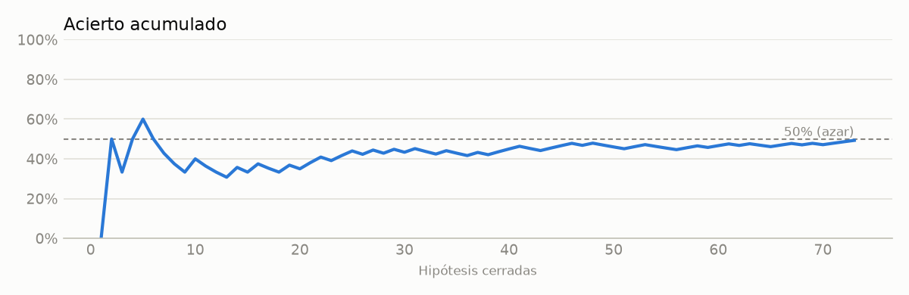

# 📊 Radar de mercados

**jueves 26 nov 2026 · revisión de cierre EE. UU. · 22:53 (Madrid)**

Proyecto de I+D · simulación (paper trading) · no es asesoramiento financiero

> **Clima:** 🟡 mixto  
> Desde la revisión de apertura, Europa cierra con fuerza (IBEX +2,3%, Euro Stoxx +2,0%, DAX +2,1%) por los aranceles de EE. UU. menos duros de lo temido y la continuidad en el BCE con De Cos. Wall Street ha estado cerrado por Acción de Gracias y los futuros del S&P terminaron al alza. Las actas del BCE son restrictivas (otra subida si no mejora la inflación) y las apuestas de subida de la Fed en diciembre siguen vivas. El Brent se queda en -3,0% (antes -4,3%) y el oro rebota +1,6%.  
> **Decisión:** no operar hoy — Ninguna hipótesis nueva supera EV >= 1% con p >= 55 tras costes; los mercados están distorsionados por el festivo de EE. UU. y los rebotes ya están en precio.

| Activo | Último | Día | 1 mes | Tendencia |
|---|--:|--:|--:|---|
| **S&P 500** | 7.183 | 🔴▼ -0.3% | 🔴▼ -7.0% | ↘️ bajista |
| **Nasdaq 100** | 26.047 | 🔴▼ -0.6% | 🔴▼ -12.2% | ↘️ bajista |
| **IBEX 35** | 19.058 | 🔵▲ +2.3% | 🔵▲ +0.9% | ➡️ lateral |
| **Nikkei 225** | 57.012 | 🔴▼ -2.8% | 🔴▼ -9.1% | ↘️ bajista |
| **Bono EE. UU. 10a (%)** | 4.848 | ▼ -6 pb | ▼ -14 pb | ➡️ lateral |
| **EUR/USD** | 1.097 | 🔵▲ +0.1% | 🔴▼ -1.4% | ↘️ bajista |
| **Brent** | 91.73 | 🔴▼ -3.0% | 🔴▼ -20.5% | ↘️ bajista |
| **Oro** | 3.593 | 🔵▲ +1.6% | 🔴▼ -11.3% | ↘️ bajista |
| **Bitcoin** | 60.788 | 🔵▲ +0.7% | 🔴▼ -20.0% | ↘️ bajista |

<picture><source media="(prefers-color-scheme: dark)" srcset="assets/mapa-dark.png"></picture>

## 🕒 Hoy, sesión a sesión

> **Resumen del día:** Asia llegó a la jornada tras caídas el día 25 (Nikkei -2,8%, Shanghái -2,0%, Hang Seng -1,1%) y rebotó el día 26 al conocerse unos aranceles de EE. UU. menos agresivos, según los titulares; la tabla aún no recoge ese dato. Europa abrió con subidas cercanas al 2% y cerró cerca de esos niveles, con los bancos españoles liderando (Santander +4,1%) y las actas del BCE como contrapeso restrictivo. EE. UU. no ha operado hoy por festivo: el último cierre (25-nov) es negativo para tecnología (NDX -0,6%, NVDA -3,9%, SMH -1,0%) y los futuros subieron algo. Los datos fuertes de PIB e inflación sostienen las apuestas de subida de la Fed en diciembre. El Brent cae un 3%, el oro rebota y las cripto siguen frágiles, con salidas récord de ETF de bitcoin.

- **09:52 · apertura Europa** 🟡 En la apertura de Europa los mercados rebotan con fuerza (Euro Stoxx +2,0%, DAX +1,9%, IBEX +1,8%, bancos españoles +3%) tras comprobar que los aranceles de EE. UU. son menos agresivos de lo temido; Asia ya había subido. Persisten las señales de inflación alta en EE. UU. (apuestas de subida de la Fed), con oro y cripto frágiles y el Brent cayendo un 4,3%.
- **22:53 · cierre EE. UU.** 🟡 Desde la revisión de apertura, Europa cierra con fuerza (IBEX +2,3%, Euro Stoxx +2,0%, DAX +2,1%) por los aranceles de EE. UU. menos duros de lo temido y la continuidad en el BCE con De Cos. Wall Street ha estado cerrado por Acción de Gracias y los futuros del S&P terminaron al alza. Las actas del BCE son restrictivas (otra subida si no mejora la inflación) y las apuestas de subida de la Fed en diciembre siguen vivas. El Brent se queda en -3,0% (antes -4,3%) y el oro rebota +1,6%.

## 📰 Noticias clave

- **[macro]** [US economy roars ahead in third quarter, inflation remains high in October](https://news.google.com/rss/articles/CBMihgFBVV95cUxNalBrRjhRWHdhRDduMzduLU1kN1lGVFpzNFllX0RzdjJXMjdtajRZS1l1dms2MFJFbkhJQmx3Qzgydi1nTTJnQ1JPLUtoa1R5LWZjWjItUXJhXzhoZG51NU9ENzVBQjVSZWFpdHlqbV9PSkVncWtjUlptdXhjd0ZKRXZ6d2Y1dw?oc=5) Reuters · 25/11 23:06 · ●  
  Sorpresa al alza en crecimiento (PIB del 3T fuerte) con inflación aún alta; refuerza el escenario de tipos altos. **Impacto:** Eleva la probabilidad de subida de la Fed en diciembre: negativo para tecnología de larga duración y cripto, apoyo relativo para financieras y dólar.
- **[macro]** [Hawkish Fed poised to raise rates despite stock market turmoil](https://news.google.com/rss/articles/CBMihAFBVV95cUxNREd0RUx1TTJiVHRreUdrdTRYNk5HdVNmMFp4SURfa3c2S1NmalFseWJ5VnZqWkxJZ1gzR1FtZkNjZnJWRzRrU05hNUJCYVhOdGk2RzJRU1NiTVRnYXd4bThxWlhZSmpsMzlGMXZGc0lPaFo3R0FydU5fYkc0Y1c1U0pzSUY?oc=5) Financial Times · 26/11 15:58 · ●  
  Parcialmente descontada: el mercado ya apuesta por una subida, pero el FT la presenta como decisión tomada pese a la volatilidad bursátil. **Impacto:** Presión sobre NDX, SMH, Russell 2000 y cripto; el dólar sube a máximos de 52 semanas y el oro choca con rendimientos altos.
- **[macro]** [ECB Saw Need for Another Rate Hike Unless Inflation Outlook Improved ‘Significantly’](https://news.google.com/rss/articles/CBMi0AFBVV95cUxOU2g3T2NNRnFfQ3pTa3ZBaldiSjZlOElVeV9ubUJpQWQ4ZXhRRzJ1VWtDZVpXUnhMajVQXzRTemdoVml3WUVoQm9NNzlwd1A3N3BjVm44VExaYWhLelQyTkppcmNxNnRIRElVYnhOUThpcl9uZ3FTQUNIQU1WMk1iLV9YZU5RZ2M0dkhiOFotUk5MRGFxRWg4dzk2MFVJX25sa3RjZVVYeElVR1l4dEx2REFiU0NZZUFndUFvZGFMY29oTFNuZFpCVjFuMjNuSm92?oc=5) WSJ · 26/11 14:26 · ●  
  Tono restrictivo no del todo esperado: el BCE veía necesaria otra subida salvo mejora 'significativa' de la inflación. **Impacto:** Limita el rebote europeo y apoya a los bancos por márgenes de intereses; negativo para sectores sensibles a tipos.
- **[política/regulación]** [European stocks end higher on easing tariff fears, ECB leadership continuity](https://news.google.com/rss/articles/CBMisAFBVV95cUxOWDAyOS03ZTA0ZzRTRmR6d2diZDJ5X0V0ejhjSlg1MzhMaTlCNU1LNTBCYVlJS2VhVV9USmNxYnNGYk9CaTdYckN1NVBZLWNKQm9BYXB5SEpNYVMyN3hzbFRjaExPY3piakNDakM1Qm1NSDJ1MFJLZzF3NGN5TFVCYThrYmNzZFhyVzN1bVBhaXh6a2t4cUxNQzBGUnpWVVFxb1l2cFR5WE1UZ0tvUEpDcw?oc=5) Reuters · 26/11 18:43 · ●  
  Sorpresa positiva relativa: los aranceles propuestos son menos agresivos de lo temido, además de la continuidad en el BCE. **Impacto:** Impulsa Euro Stoxx, DAX e IBEX (+2% a +2,3%), sobre todo bancos y cíclicos; el rebote se produce con EE. UU. cerrado y poco volumen.
- **[resultados]** [S&P warns Nvidia credit rating could be cut over 'rising' management and governance risk](https://www.cnbc.com/2026/11/26/nvidia-market-governance-risk.html) CNBC · 26/11 04:19 · ●  
  Nueva y posterior al cierre de EE. UU. del día 25: S&P avisa de un posible recorte de rating de Nvidia por riesgo de gestión y gobernanza. **Impacto:** Negativo para NVDA y semiconductores (SMH, ASML) en la reapertura de EE. UU.; el efecto fundamental es limitado, pero daña el sentimiento tras una caída del 31% en un mes.
- **[cripto]** [Spot bitcoin ETFs are on track for their biggest monthly outflow on record](https://news.google.com/rss/articles/CBMirgFBVV95cUxOWFBld3hBWS0tVGRiRjJxdS1tRkVPbTV1c0Rzb2VfUGpXRVVpZlFMdUxEYXhQTUotQnVMbzc5X3dHVUVnZ2N6UmR2RGhHWWRJRG84WkFtaUktZDNRNzJCaDhLZ1dOU1U4S29yS2NIUHgwcVdjYklMMF9rMThsSVFPYTJnVG1kdjBTMVY5X0VkZi1FOU1vQUY1dTQ1cVY2SUkwZFdianZrLTJOekVSQUE?oc=5) CoinDesk · 26/11 13:14 · ●  
  Confirma una tendencia ya conocida: los ETF de bitcoin al contado van hacia su mayor salida mensual de la historia. **Impacto:** Presión vendedora estructural sobre BTC, ETH y SOL; Galaxy retira su suelo y avisa de 28.200 $ si cae el mínimo de junio.

**Divergencias precio-noticia:** Europa sube ~2% pese a unas actas del BCE restrictivas y a una Fed que se prepara para subir: el mercado solo pondera el alivio arancelario. · El oro rebota +1,6% pese a titulares de caída por las apuestas de subida de tipos; apunta a miedo de recesión o a un rebote técnico, no a un cambio de tipos. · El Brent cae un 3% mientras XLE (cierre del 25) no ha podido reflejarlo; la reapertura de EE. UU. puede abrir un hueco a la baja. · BTC sube +0,7% pese a salidas récord de ETF y a la retirada del suelo de Galaxy: rebote por sobreventa más que cambio de tendencia. · Shanghái (-2,6σ) y Hang Seng cerraron el día 25 en mínimos de 52 semanas, pero los titulares apuntan a subidas asiáticas el 26 que la tabla aún no recoge.

## 🎯 Hipótesis de hoy

| Activo | Idea | Plazo | Objetivo / stop | Prob. | EV neto |
|---|---|--:|--:|--:|--:|
| 🔵▲ **Hang Seng** | Rebote desde sobreventa (RSI 27, mínimos de 52 semanas) con alivio arancelario ya visible en Asia y Europa, que aún no está del todo en el último precio de la tabla. | 5 ses. | +3.0% / −2.0% | 44% | +0.1% 👀 |
| 🔴▼ **Energía (XLE)** | El Brent cae un 3% el día 26 con EE. UU. cerrado, y XLE no lo ha reflejado; se espera un ajuste a la baja en la reapertura dentro de una tendencia bajista del crudo (-20% en 1 mes). | 3 ses. | +2.5% / −1.6% | 47% | +0.2% 👀 |
| 🔴▼ **NVIDIA** | El aviso de S&P sobre el rating, publicado tras el cierre de EE. UU., aún no está en el precio; la reapertura puede reflejarlo sumado a la presión sobre semiconductores y al sesgo restrictivo de la Fed. | 3 ses. | +8.0% / −5.0% | 40% | +0.1% 👀 |

Argumentos en contra

- **Hang Seng** · La tendencia es bajista, el dólar está en máximos y una Fed restrictiva puede reanudar las caídas; parte del rebote del día 26 puede estar ya hecho. Sesgos: Sesgo de reversión a la media y de anclaje en el mínimo; riesgo de gap al abrir.
- **Energía (XLE)** · La correlación entre XLE y el Brent es imperfecta, el Brent puede recuperar parte de la caída antes de la apertura y XLE ya cayó un 10,7% en un mes. Sesgos: Extrapolo la tendencia; desconozco la causa de la caída del Brent. Cruce con otros riesgos de mercado: no operar con certeza.
- **NVIDIA** · Tras caer un 31% en un mes, la acción está muy vendida y un rebote violento es probable; el rating de Nvidia tiene poco peso para su valoración y su liquidez es enorme. Sesgos: Sesgo narrativo (una noticia negativa parece decisiva) y riesgo de perseguir lo ya caído; volatilidad del 8,7% diaria hace que el stop pueda saltar por ruido.

Prob.: probabilidad de tocar el objetivo antes que el stop · EV: valor esperado neto de costes · ✅ se opera en simulación (EV ≥ 1% y prob. ≥ 55%) · 👀 solo se mide

## 👀 Valores a vigilar

- **S&P 500** — Reapertura de EE. UU. tras el festivo: confirma o no el rebote europeo y la reacción a las apuestas de subida de la Fed.
- **Brent** — Caída del 3% con causa no clara; condiciona XLE y la inflación esperada.
- **Bitcoin** — Mínimo de junio como nivel clave (Galaxy avisa de 28.200 $ si se rompe); salidas récord de ETF.
- **Índice dólar** — En máximos de 52 semanas; una Fed restrictiva refuerza el dólar y presiona oro y cripto.
- **IBEX 35** — Movimiento anómalo de +2,1σ con poco volumen por el festivo de EE. UU.; riesgo de devolver parte de lo ganado.
- **Hang Seng** — en mínimos de 52 semanas, sobreventa (RSI 27)
- **Shanghái Compuesto** — movimiento anómalo hoy (-2.6σ), en mínimos de 52 semanas, sobreventa (RSI 27)
- **EUR/USD** — en mínimos de 52 semanas
- **Apple** — en máximos de 52 semanas

## 🧪 Test en vivo: deriva tras resultados

Regla congelada desde el 2026-10-15: comprar al cierre del día siguiente a una reacción a resultados entre el 10% mejor y vender 40 sesiones después. Objetivo: ≥ 1% neto por operación. [Por qué esta regla](reports/pead.md)

Aún sin operaciones cerradas (cada una dura unos 2 meses). Abiertas: 34.

**Se compran en la próxima sesión:** HPQ (reacción +11.8%)

| Empresa | Entrada | Sesiones | Resultado | SPY mismo periodo |
|---|---|--:|--:|--:|
| DLTR | 2026-11-25 | 0/40 | +0.0% | +0.0% |
| PANW | 2026-11-20 | 3/40 | +3.7% | +3.9% |
| TJX | 2026-11-19 | 4/40 | +4.8% | +0.1% |
| TSN | 2026-11-17 | 6/40 | -0.2% | -2.1% |
| TTWO | 2026-11-11 | 10/40 | -1.7% | -5.7% |
| FERG | 2026-11-10 | 11/40 | -0.9% | -4.4% |
| CF | 2026-11-06 | 13/40 | -1.6% | -2.5% |
| CPAY | 2026-11-06 | 13/40 | -0.2% | -2.5% |
| TPR | 2026-11-06 | 13/40 | -2.4% | -2.5% |
| VRSK | 2026-11-06 | 13/40 | +0.1% | -2.5% |
| CDW | 2026-11-05 | 14/40 | +10.5% | -2.2% |
| JKHY | 2026-11-05 | 14/40 | +1.0% | -2.2% |
| SWK | 2026-11-05 | 14/40 | -5.2% | -2.2% |
| ZBH | 2026-11-05 | 14/40 | +3.0% | -2.2% |
| FISV | 2026-11-04 | 15/40 | -3.7% | -6.5% |
| IDXX | 2026-11-03 | 16/40 | +5.6% | -5.0% |
| CBOE | 2026-11-02 | 17/40 | +0.7% | -4.7% |
| REGN | 2026-11-02 | 17/40 | +2.1% | -4.7% |
| VLTO | 2026-11-02 | 17/40 | +3.9% | -4.7% |
| CVNA | 2026-10-30 | 18/40 | -0.7% | -5.2% |
| GEN | 2026-10-30 | 18/40 | +3.6% | -5.2% |
| HII | 2026-10-30 | 18/40 | -5.5% | -5.2% |
| NCLH | 2026-10-30 | 18/40 | -3.2% | -5.2% |
| TXT | 2026-10-30 | 18/40 | -5.6% | -5.2% |
| FLEX | 2026-10-29 | 19/40 | -27.8% | -6.8% |
| LH | 2026-10-29 | 19/40 | +0.4% | -6.8% |
| VRT | 2026-10-29 | 19/40 | -29.5% | -6.8% |
| PNR | 2026-10-28 | 20/40 | +13.2% | -7.2% |
| ALLE | 2026-10-23 | 23/40 | +7.4% | -5.7% |
| BX | 2026-10-23 | 23/40 | +0.8% | -5.7% |
| NDAQ | 2026-10-23 | 23/40 | +4.4% | -5.7% |
| ROP | 2026-10-23 | 23/40 | +10.3% | -5.7% |
| EFX | 2026-10-21 | 25/40 | +5.8% | -7.3% |
| HAS | 2026-10-21 | 25/40 | -3.0% | -7.3% |

## 📈 Tendencias (6 meses)

<picture><source media="(prefers-color-scheme: dark)" srcset="assets/tendencias-dark.png"></picture>

Todos los activos

| Activo | Último | Día | Semana | 1 mes | 3 meses | RSI | Tendencia | Señales |
|---|--:|--:|--:|--:|--:|--:|---|---|
| S&P 500 | 7.183 | 🔴▼ -0.3% | 🔴▼ -1.9% | 🔴▼ -7.0% | 🔴▼ -7.1% | 40 | ↘️ bajista | — |
| Nasdaq 100 | 26.047 | 🔴▼ -0.6% | 🔴▼ -3.9% | 🔴▼ -12.2% | 🔴▼ -12.1% | 38 | ↘️ bajista | — |
| IBEX 35 | 19.058 | 🔵▲ +2.3% | 🔴▼ -0.7% | 🔵▲ +0.9% | 🔴▼ -4.6% | 46 | ➡️ lateral | movimiento anómalo hoy (+2.1σ) |
| Euro Stoxx 50 | 6.015 | 🔵▲ +2.0% | 🔴▼ -1.6% | 🔴▼ -2.5% | 🔴▼ -6.3% | 43 | ↘️ bajista | — |
| Russell 2000 | 2.704 | 🔵▲ +0.7% | 🔴▼ -0.4% | 🔴▼ -4.1% | 🔴▼ -10.3% | 45 | ↘️ bajista | — |
| DAX | 25.216 | 🔵▲ +2.1% | 🔴▼ -1.0% | 🔴▼ -1.9% | 🔴▼ -4.0% | 44 | ➡️ lateral | — |
| Nikkei 225 | 57.012 | 🔴▼ -2.8% | 🔴▼ -3.1% | 🔴▼ -9.1% | 🔴▼ -13.9% | 37 | ↘️ bajista | — |
| Hang Seng | 21.966 | 🔴▼ -1.1% | 🔴▼ -5.7% | 🔴▼ -4.7% | 🔴▼ -14.4% | 27 | ↘️ bajista | en mínimos de 52 semanas, sobreventa (RSI 27) |
| Shanghái Compuesto | 3.476 | 🔴▼ -2.0% | 🔴▼ -3.1% | 🔴▼ -4.7% | 🔴▼ -10.9% | 27 | ↘️ bajista | movimiento anómalo hoy (-2.6σ), en mínimos de 52 semanas, sobreventa (RSI 27) |
| Bono EE. UU. 10a (%) | 4.848 | ▼ -6 pb | ▼ -22 pb | ▼ -14 pb | ▲ +18 pb | 37 | ➡️ lateral | — |
| EUR/USD | 1.097 | 🔵▲ +0.1% | 🔵▲ +0.0% | 🔴▼ -1.4% | 🔴▼ -5.3% | 35 | ↘️ bajista | en mínimos de 52 semanas |
| Índice dólar | 103.79 | 🔵▲ +0.1% | 🔴▼ -0.1% | 🔵▲ +1.6% | 🔵▲ +4.1% | 63 | ↗️ alcista | en máximos de 52 semanas |
| Brent | 91.73 | 🔴▼ -3.0% | 🔴▼ -0.3% | 🔴▼ -20.5% | 🔵▲ +2.7% | 41 | ↘️ bajista | — |
| Oro | 3.593 | 🔵▲ +1.6% | 🔴▼ -2.5% | 🔴▼ -11.3% | 🔴▼ -20.7% | 34 | ↘️ bajista | — |
| Bitcoin | 60.788 | 🔵▲ +0.7% | 🔵▲ +1.2% | 🔴▼ -20.0% | 🔴▼ -28.0% | 29 | ↘️ bajista | sobreventa (RSI 29) |
| Ethereum | 1.703 | 🔵▲ +0.7% | 🔵▲ +1.3% | 🔴▼ -23.8% | 🔴▼ -36.6% | 31 | ↘️ bajista | — |
| Solana | 71.55 | 🔵▲ +1.6% | 🔵▲ +1.9% | 🔴▼ -19.7% | 🔴▼ -38.9% | 34 | ↘️ bajista | — |
| Semiconductores (SMH) | 422.46 | 🔴▼ -1.0% | 🔴▼ -8.1% | 🔴▼ -24.3% | 🔴▼ -26.3% | 37 | ↘️ bajista | — |
| Financieras (XLF) | 56.51 | 🔵▲ +0.7% | 🔵▲ +0.2% | 🔵▲ +1.1% | 🔴▼ -2.4% | 49 | ↗️ alcista | — |
| Energía (XLE) | 60.90 | 🔵▲ +0.7% | 🔴▼ -0.6% | 🔴▼ -10.7% | 🔴▼ -2.2% | 39 | ➡️ lateral | — |
| Tecnología (XLK) | 155.79 | 🔴▼ -0.8% | 🔴▼ -4.9% | 🔴▼ -17.8% | 🔴▼ -17.4% | 37 | ↘️ bajista | — |
| NVIDIA | 149.30 | 🔴▼ -3.9% | 🔴▼ -1.1% | 🔴▼ -31.5% | 🔴▼ -34.5% | 37 | ↘️ bajista | — |
| Apple | 355.58 | 🔵▲ +0.4% | 🔵▲ +0.9% | 🔵▲ +2.4% | 🔵▲ +13.0% | 58 | ↗️ alcista | en máximos de 52 semanas |
| Microsoft | 489.93 | 🔴▼ -1.2% | 🔴▼ -3.6% | 🔴▼ -7.8% | 🔴▼ -3.0% | 39 | ➡️ lateral | — |
| ASML | 1.303 | 🔴▼ -2.5% | 🔴▼ -6.6% | 🔴▼ -20.3% | 🔴▼ -24.9% | 36 | ↘️ bajista | — |
| Banco Santander | 10.44 | 🔵▲ +4.1% | 🔴▼ -1.1% | 🔴▼ -1.9% | 🔴▼ -17.6% | 42 | ↘️ bajista | — |
| BBVA | 21.86 | 🔵▲ +2.7% | 🔴▼ -3.2% | 🔴▼ -2.6% | 🔴▼ -12.7% | 42 | ➡️ lateral | — |
| Inditex | 58.62 | 🔵▲ +2.0% | 🔵▲ +0.3% | 🔵▲ +2.7% | 🔵▲ +1.1% | 53 | ↗️ alcista | — |
| Iberdrola | 23.03 | 🔵▲ +1.4% | 🔵▲ +1.9% | 🔵▲ +4.5% | 🔵▲ +14.7% | 61 | ↗️ alcista | — |

## ✅ Historial de hipótesis

Registradas: **80** · abiertas: **7** · cerradas: **73**
- Acierto (todas): **49%** (IC 95%: 38–61%, n = 73) · retorno neto medio -0.03%
- Acierto (operadas): **0%** (IC 95%: 0–79%, n = 1) · retorno neto medio -0.55%

<picture><source media="(prefers-color-scheme: dark)" srcset="assets/historial-dark.png"></picture>

Registro completo: [`data/dashboard/hipotesis.csv`](data/dashboard/hipotesis.csv)

---

Fuentes y calidad de datos

- Precios: 3 contrastados, 26 sin segunda fuente, 0 dudosos (⚠️, difieren > 0,5%), 0 sin dato.
- Fuentes de precio usadas: Yahoo (29).
- Titulares: Google News · mercados ES: ok (100); Google News · markets: ok (100); Google News · crypto: ok (100); CNBC: ok (30); MarketWatch: ok (10); CoinDesk: ok (25); Expansión: ok (52).
- Análisis: claude-sonnet-5-5.
- Reglas de tendencia: alcista si el precio está sobre sus medias de 50 y 200 sesiones y sube en el mes; bajista al revés; si no, lateral.

Más: [experimento Polymarket 5 min](docs/experimento-polymarket.md) · [informe del backtest](reports/informe.md)
