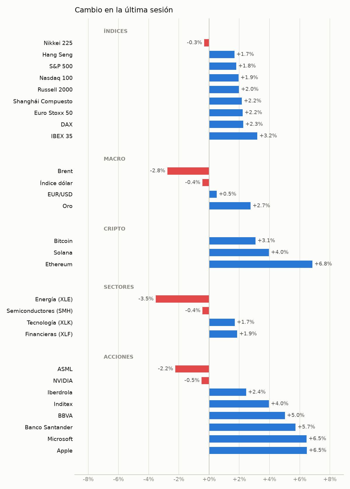
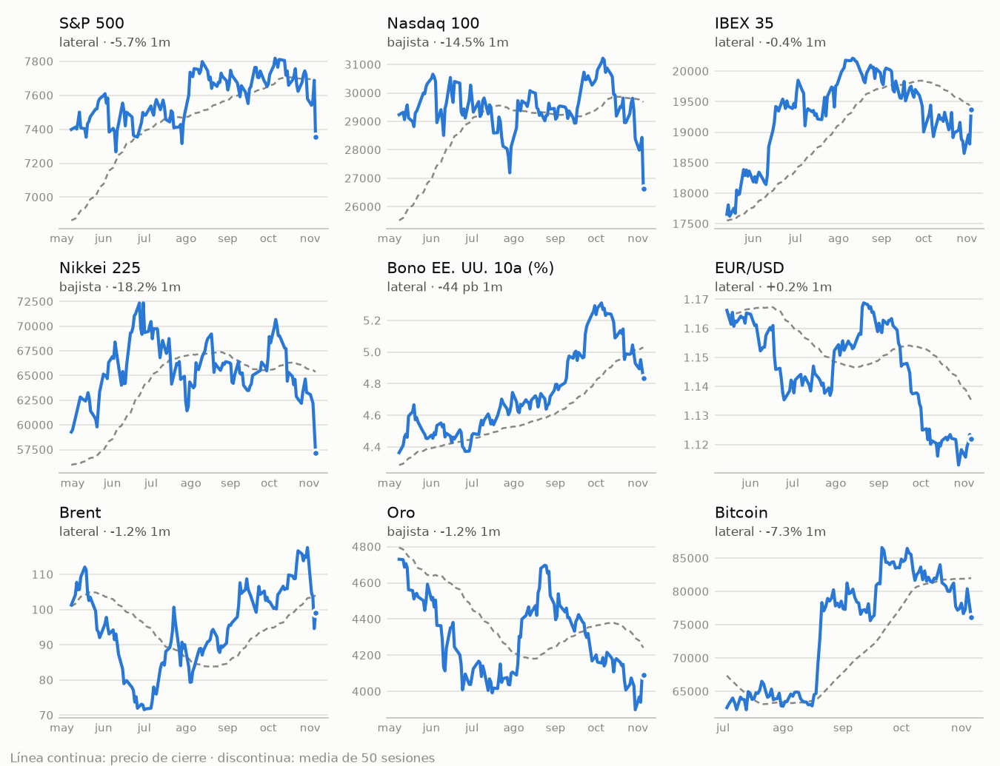
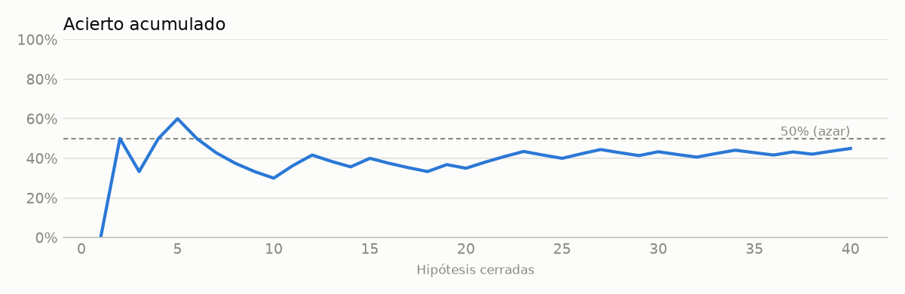

# 📊 Radar de mercados

**miércoles 4 nov 2026 · revisión de apertura Asia · 02:24 (Madrid)**

Proyecto de I+D · simulación (paper trading) · no es asesoramiento financiero

> **Clima:** 🟡 mixto  
> En la apertura de Asia el Nikkei cae un 1,9% (-9,4% en un mes) tras el cierre mixto de EE. UU. del día de las midterms. Los resultados de IA siguen divididos: AMD, Super Micro y Samsung suben, mientras Apple y Shopify caen. Los titulares sobre inflación, subidas de la Fed en diciembre y el hackeo de Binance mantienen un tono cauto.  
> **Decisión:** no operar hoy — Revisión de apertura de Asia: solo observación, sin hipótesis nuevas.

| Activo | Último | Día | 1 mes | Tendencia |
|---|--:|--:|--:|---|
| **S&P 500** | 7.569 | 🔵▲ +0.4% | 🔴▼ -2.6% | ➡️ lateral |
| **Nasdaq 100** | 28.180 | 🔵▲ +0.7% | 🔴▼ -9.3% | ➡️ lateral |
| **IBEX 35** | 18.958 | 🔵▲ +1.6% | 🔴▼ -0.7% | ➡️ lateral |
| **Nikkei 225** | 61.885 | 🔴▼ -1.9% | 🔴▼ -9.4% | ➡️ lateral |
| **Bono EE. UU. 10a (%)** | 4.952 | ▲ +6 pb | ▼ -36 pb | ➡️ lateral |
| **EUR/USD** | 1.124 | 🔵▲ +0.5% | 🔵▲ +0.2% | ➡️ lateral |
| **Brent** | 104.37 | 🔴▼ -0.4% | 🔵▲ +4.0% | ↗️ alcista |
| **Oro** | 3.949 | 🔴▼ -0.5% | 🔴▼ -5.0% | ↘️ bajista |
| **Bitcoin** | 76.925 | 🔵▲ +0.3% | 🔴▼ -7.4% | ➡️ lateral |

<picture><source media="(prefers-color-scheme: dark)" srcset="assets/mapa-dark.png"></picture>

## 🕒 Hoy, sesión a sesión

- **02:24 · apertura Asia** 🟡 En la apertura de Asia el Nikkei cae un 1,9% (-9,4% en un mes) tras el cierre mixto de EE. UU. del día de las midterms. Los resultados de IA siguen divididos: AMD, Super Micro y Samsung suben, mientras Apple y Shopify caen. Los titulares sobre inflación, subidas de la Fed en diciembre y el hackeo de Binance mantienen un tono cauto.
- apertura Europa · prevista ~09:15
- cierre Asia · prevista ~09:25
- apertura EE. UU. · prevista ~15:45
- cierre Europa · prevista ~17:50
- cierre EE. UU. · prevista ~22:15

## 📰 Noticias clave

- **[resultados]** [AMD stock jumps 8% on earnings as data center revenue nearly doubles](https://www.cnbc.com/2026/11/03/amd-amd-q3-earnings-report-2026-.html) CNBC · 04/11 00:04 · ●●●●  
  Sorpresa positiva: los ingresos de centros de datos casi se duplican y la acción llegaba muy castigada. **Impacto:** Apoyo a semiconductores y a la cadena de IA (NVDA, SMH); dirección alcista, aunque el sector sigue en tendencia bajista.
- **[geopolítica]** [U.S. Stocks Mixed Amid Midterm, Iran War Nerves](https://news.google.com/rss/articles/CBMikwFBVV95cUxQQXFUeW5rcXZfV1hvWEJ1VzNDNXkyMi1zUF84dmFJVFltTWEydFUxV2ZuMXhUOVBwQ0Y0MkdrQ2pOUTMxZDFrRkJRU25LWWFYbmZGWjlNMF9GcnZuMldObjMzcTRMck1jT2JLaUVnd25ZanM0R0tzdjdGeE56eGFWLUlmeHFSVlZpbkJMTnhzN0VqX1U?oc=5) WSJ · 03/11 23:08 · ●●●  
  Esperada: la cautela por las midterms y la guerra con Irán ya estaba en los precios y el cierre fue mixto. **Impacto:** Índices de EE. UU. sin dirección clara; el resultado electoral puede mover tipos, dólar y sectores sensibles a la política, con riesgo de gap en Asia.
- **[resultados]** [Super Micro’s stock pops as earnings show booming demand for AI servers](https://www.marketwatch.com/story/super-micros-stock-pops-as-earnings-show-booming-demand-for-ai-servers-2d179658?mod=mw_rss_topstories) MarketWatch · 04/11 02:12 · ●●●  
  Sorpresa positiva: la demanda de servidores de IA es fuerte según Super Micro. **Impacto:** Refuerza la tesis de inversión en IA y podría ayudar a los semiconductores y al Nikkei en la apertura asiática.
- **[resultados]** [Samsung’s Chip Profit Drives Another Record Quarter](https://news.google.com/rss/articles/CBMipgFBVV95cUxPSkNHdjdvWXZoRUpjZkRXQTJKd2JhcjJqbjNFV1hkYlNXNXNPX1JubjRiTVFVaWc3XzFrZkdMRUl4cHFyU1dDRkREQ29VSF9mQ29LZjB3VkhUQzRoblZjSV9MX3VBVDJab25oMkM1NElMWWFVS0drQ2JjTUd6Z2loNnJmcHRXYXA0OFh5RnI5cG5leTNraFBMdjVkZVgxMkxZeklIak53?oc=5) WSJ · 04/11 01:12 · ●●●  
  Parcialmente esperada: el ciclo de memoria era conocido, pero otro trimestre récord de Samsung es positivo. **Impacto:** Favorece a los valores de chips y memoria de Asia (Corea, Japón) y a SMH; dirección alcista.
- **[resultados]** [What analysts are telling us while Apple’s stock falls after earnings report](https://www.marketwatch.com/story/what-analysts-are-saying-as-apples-stock-falls-after-earnings-report-f0afa357?mod=mw_rss_topstories) MarketWatch · 03/11 23:48 · ●●●  
  Negativa: Apple cae tras presentar resultados, con previsión de márgenes débiles según el contexto de las hipótesis abiertas. **Impacto:** Presión sobre AAPL y, en menor medida, sobre proveedores asiáticos y el Nasdaq.
- **[macro]** [Mortgage Rates Climb in October Amid Accelerating Inflation](https://news.google.com/rss/articles/CBMimAFBVV95cUxQV0JacWxuT2dlaVpHOTgtZERQZXZmNXZFWGN3ZUFLQjF1VlFxeVZONDVwd3E2d3FhN1I3NWUxVDA2amtDQW9JOVg5dFlZUUhsUlZhYWZRRjd3UUI1eGlmaXpFdE84QVd5Z0plV2JMbUtVN0l3a19icEZyd3IzTGpuci12eHk1YmRDc0J5Y0laejZObW15YTVkUg?oc=5) Eye On Housing · 03/11 22:43 · ●●●  
  Confirma una tendencia conocida: los tipos hipotecarios suben en octubre con la inflación acelerándose. **Impacto:** Los rendimientos altos (10 años cerca del 5%) y las expectativas de subida de la Fed en diciembre (id 32) presionan a los activos de larga duración y a las small caps.

**Divergencias precio-noticia:** El Nikkei cae un 1,9% mientras AMD, Super Micro y Samsung dan buenas noticias de IA: el mercado japonés parece pesar más la debilidad previa del sector tecnológico y el riesgo electoral que los resultados. · SMH cae un 2,7% (cierre del 2 de noviembre), aunque los resultados posteriores de AMD y Super Micro son positivos: la reacción podría estar desfasada respecto a las noticias nuevas.

## 🎯 Hipótesis de hoy

_Revisión de apertura Asia: solo observación. Las hipótesis se registran con precios de cierre de EE. UU. Estas son las registradas en el cierre del 2026-11-03._

| Activo | Idea | Plazo | Objetivo / stop | Prob. | EV neto |
|---|---|--:|--:|--:|--:|
| 🔴▼ **Apple** | Previsión de márgenes débiles y advertencia sobre agentes de IA, con ruptura a la baja de la media de 50 sesiones mientras el resto de la tecnología rebota, sugieren continuación de la debilidad relativa. | 5 ses. | +2.5% / −1.6% | 45% | +0.1% 👀 |
| 🔴▼ **Energía (XLE)** | XLE ha caído solo un -2,2% en 5 días frente al -8,3% del Brent; si se consolida el acuerdo con Irán, el sector aún tiene margen para ajustarse. | 5 ses. | +3.0% / −2.0% | 40% | -0.1% 👀 |

Prob.: probabilidad de tocar el objetivo antes que el stop · EV: valor esperado neto de costes · ✅ se opera en simulación (EV ≥ 1% y prob. ≥ 55%) · 👀 solo se mide

## 👀 Valores a vigilar

- **Nikkei 225** — Cae un 1,9% en la apertura con los resultados de IA como posible catalizador de rebote.
- **Semiconductores (SMH)** — Comprobar si el rebote tras los resultados de AMD y Super Micro se confirma en EE. UU.
- **Bono EE. UU. 10a (%)** — Rendimiento cerca del 5%: clave para tecnología, small caps y dólar.
- **Bitcoin** — Se debilita mientras llegan los resultados electorales; el hackeo de Binance sigue afectando al sentimiento.
- **Brent** — La evolución de las negociaciones con Irán puede cambiar la prima de riesgo.
- **Solana** — sobreventa (RSI 27)
- **Financieras (XLF)** — movimiento anómalo hoy (+2.3σ)
- **Energía (XLE)** — movimiento anómalo hoy (-2.9σ)
- **Microsoft** — movimiento anómalo hoy (-2.1σ), cruza a la baja su media de 50 sesiones
- **Banco Santander** — sobreventa (RSI 29)
- **Iberdrola** — en máximos de 52 semanas, sobrecompra (RSI 73)

## 🧪 Test en vivo: deriva tras resultados

Regla congelada desde el 2026-10-15: comprar al cierre del día siguiente a una reacción a resultados entre el 10% mejor y vender 40 sesiones después. Objetivo: ≥ 1% neto por operación. [Por qué esta regla](reports/pead.md)

Aún sin operaciones cerradas (cada una dura unos 2 meses). Abiertas: 18.

| Empresa | Entrada | Sesiones | Resultado | SPY mismo periodo |
|---|---|--:|--:|--:|
| IDXX | 2026-11-03 | 0/40 | +nan% | +nan% |
| CBOE | 2026-11-02 | 1/40 | +nan% | +nan% |
| REGN | 2026-11-02 | 1/40 | +nan% | +nan% |
| VLTO | 2026-11-02 | 1/40 | +nan% | +nan% |
| CVNA | 2026-10-30 | 2/40 | +nan% | +nan% |
| GEN | 2026-10-30 | 2/40 | +nan% | +nan% |
| HII | 2026-10-30 | 2/40 | +nan% | +nan% |
| NCLH | 2026-10-30 | 2/40 | +nan% | +nan% |
| TXT | 2026-10-30 | 2/40 | +nan% | +nan% |
| FLEX | 2026-10-29 | 3/40 | +nan% | +nan% |
| VRT | 2026-10-29 | 3/40 | +nan% | +nan% |
| PNR | 2026-10-28 | 4/40 | +nan% | +nan% |
| ALLE | 2026-10-23 | 7/40 | +nan% | +nan% |
| BX | 2026-10-23 | 7/40 | +nan% | +nan% |
| NDAQ | 2026-10-23 | 7/40 | +nan% | +nan% |
| ROP | 2026-10-23 | 7/40 | +nan% | +nan% |
| EFX | 2026-10-21 | 9/40 | +nan% | +nan% |
| HAS | 2026-10-21 | 9/40 | +nan% | +nan% |

## 📈 Tendencias (6 meses)

<picture><source media="(prefers-color-scheme: dark)" srcset="assets/tendencias-dark.png"></picture>

Todos los activos

| Activo | Último | Día | Semana | 1 mes | 3 meses | RSI | Tendencia | Señales |
|---|--:|--:|--:|--:|--:|--:|---|---|
| S&P 500 | 7.569 | 🔵▲ +0.4% | 🔴▼ -2.0% | 🔴▼ -2.6% | 🔴▼ -2.0% | 40 | ➡️ lateral | — |
| Nasdaq 100 | 28.180 | 🔵▲ +0.7% | 🔴▼ -5.0% | 🔴▼ -9.3% | 🔴▼ -4.4% | 35 | ➡️ lateral | — |
| IBEX 35 | 18.958 | 🔵▲ +1.6% | 🔴▼ -0.4% | 🔴▼ -0.7% | 🔴▼ -5.5% | 45 | ➡️ lateral | — |
| Euro Stoxx 50 | 6.176 | 🔵▲ +0.7% | 🔵▲ +1.0% | 🔴▼ -1.0% | 🔴▼ -4.6% | 49 | ➡️ lateral | — |
| Russell 2000 | 2.812 | 🔵▲ +0.2% | 🔴▼ -0.2% | 🔴▼ -1.2% | 🔴▼ -6.8% | 50 | ➡️ lateral | — |
| DAX | 25.981 | 🔵▲ +0.6% | 🔵▲ +2.2% | 🔵▲ +3.0% | 🔴▼ -0.6% | 59 | ↗️ alcista | — |
| Nikkei 225 | 61.885 | 🔴▼ -1.9% | 🔴▼ -2.2% | 🔴▼ -9.4% | 🔵▲ +0.0% | 37 | ➡️ lateral | — |
| Hang Seng | 23.393 | 🔵▲ +0.4% | 🔵▲ +0.8% | 🔴▼ -5.0% | 🔴▼ -10.1% | 41 | ↘️ bajista | — |
| Shanghái Compuesto | 3.638 | 🔵▲ +1.1% | 🔴▼ -1.6% | 🔴▼ -6.4% | 🔴▼ -4.6% | 35 | ↘️ bajista | — |
| Bono EE. UU. 10a (%) | 4.952 | ▲ +6 pb | ▼ -4 pb | ▼ -36 pb | ▲ +34 pb | 42 | ➡️ lateral | — |
| EUR/USD | 1.124 | 🔵▲ +0.5% | 🔵▲ +1.0% | 🔵▲ +0.2% | 🔴▼ -2.4% | 50 | ➡️ lateral | — |
| Índice dólar | 101.49 | 🔴▼ -0.3% | 🔴▼ -0.8% | 🔴▼ -0.7% | 🔵▲ +1.8% | 47 | ➡️ lateral | — |
| Brent | 104.37 | 🔴▼ -0.4% | 🔴▼ -8.4% | 🔵▲ +4.0% | 🔵▲ +31.4% | 44 | ↗️ alcista | — |
| Oro | 3.949 | 🔴▼ -0.5% | 🔴▼ -3.1% | 🔴▼ -5.0% | 🔴▼ -8.3% | 35 | ↘️ bajista | — |
| Bitcoin | 76.925 | 🔵▲ +0.3% | 🔴▼ -1.1% | 🔴▼ -7.4% | 🔴▼ -0.6% | 36 | ➡️ lateral | — |
| Ethereum | 2.265 | 🔵▲ +0.7% | 🔵▲ +0.7% | 🔴▼ -9.3% | 🔴▼ -6.3% | 36 | ➡️ lateral | — |
| Solana | 92.12 | 🔵▲ +0.3% | 🔴▼ -3.5% | 🔴▼ -13.7% | 🔴▼ -7.9% | 27 | ➡️ lateral | sobreventa (RSI 27) |
| Semiconductores (SMH) | 508.31 | 🔴▼ -2.7% | 🔴▼ -6.2% | 🔴▼ -19.4% | 🔴▼ -11.7% | 34 | ↘️ bajista | — |
| Financieras (XLF) | 57.56 | 🔵▲ +1.9% | 🔵▲ +2.7% | 🔵▲ +7.6% | 🔴▼ -0.6% | 65 | ↗️ alcista | movimiento anómalo hoy (+2.3σ) |
| Energía (XLE) | 67.25 | 🔴▼ -4.0% | 🔴▼ -3.4% | 🔵▲ +7.1% | 🔵▲ +14.9% | 52 | ↗️ alcista | movimiento anómalo hoy (-2.9σ) |
| Tecnología (XLK) | 174.22 | 🔴▼ -2.9% | 🔴▼ -6.5% | 🔴▼ -12.8% | 🔴▼ -6.8% | 32 | ➡️ lateral | — |
| NVIDIA | 202.06 | 🔴▼ -1.3% | 🔴▼ -6.5% | 🔴▼ -13.6% | 🔴▼ -4.7% | 33 | ↘️ bajista | — |
| Apple | 338.32 | 🔴▼ -1.8% | 🔴▼ -1.6% | 🔵▲ +1.4% | 🔵▲ +9.4% | 48 | ↗️ alcista | — |
| Microsoft | 507.12 | 🔴▼ -2.8% | 🔴▼ -4.8% | 🔴▼ -2.0% | 🔵▲ +2.9% | 40 | ➡️ lateral | movimiento anómalo hoy (-2.1σ), cruza a la baja su media de 50 sesiones |
| ASML | 1.526 | 🔴▼ -2.5% | 🔴▼ -4.1% | 🔴▼ -18.3% | 🔴▼ -10.9% | 36 | ↘️ bajista | — |
| Banco Santander | 10.39 | 🔵▲ +2.6% | 🔴▼ -6.9% | 🔴▼ -12.0% | 🔴▼ -18.6% | 29 | ↘️ bajista | sobreventa (RSI 29) |
| BBVA | 21.58 | 🔵▲ +2.5% | 🔴▼ -5.1% | 🔴▼ -9.1% | 🔴▼ -11.2% | 35 | ➡️ lateral | — |
| Inditex | 57.50 | 🔵▲ +2.4% | 🔵▲ +0.5% | 🔵▲ +8.0% | 🔴▼ -1.7% | 64 | ↗️ alcista | — |
| Iberdrola | 22.25 | 🔵▲ +0.3% | 🔵▲ +1.3% | 🔵▲ +6.9% | 🔵▲ +8.1% | 73 | ↗️ alcista | en máximos de 52 semanas, sobrecompra (RSI 73) |

## ✅ Historial de hipótesis

Registradas: **42** · abiertas: **11** · cerradas: **31**
- Acierto (todas): **45%** (IC 95%: 29–62%, n = 31) · retorno neto medio -0.24%
- Acierto (operadas): **0%** (IC 95%: 0–79%, n = 1) · retorno neto medio -0.55%

<picture><source media="(prefers-color-scheme: dark)" srcset="assets/historial-dark.png"></picture>

Registro completo: [`data/dashboard/hipotesis.csv`](data/dashboard/hipotesis.csv)

---

Fuentes y calidad de datos

- Precios: 3 contrastados, 26 sin segunda fuente, 0 dudosos (⚠️, difieren > 0,5%), 0 sin dato.
- Fuentes de precio usadas: Yahoo (29).
- Titulares: Google News · mercados ES: ok (100); Google News · markets: ok (100); Google News · crypto: ok (100); CNBC: ok (30); MarketWatch: ok (10); CoinDesk: ok (25); Expansión: ok (52).
- Análisis: claude-sonnet-5-5.
- Reglas de tendencia: alcista si el precio está sobre sus medias de 50 y 200 sesiones y sube en el mes; bajista al revés; si no, lateral.

Más: [experimento Polymarket 5 min](docs/experimento-polymarket.md) · [informe del backtest](reports/informe.md)
