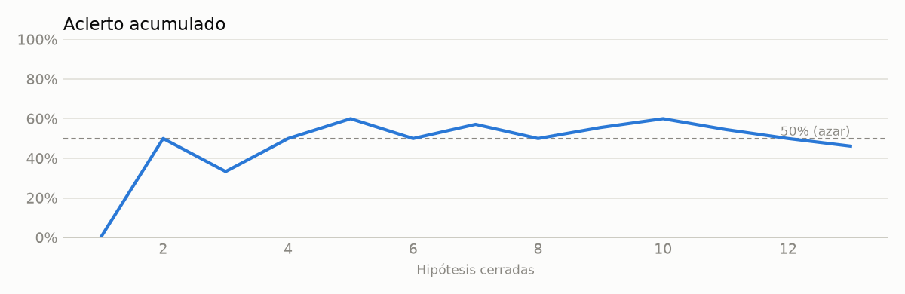

# 📊 Radar de mercados

**lunes 26 oct 2026 · revisión de cierre Europa · 17:52 (Madrid)**

Proyecto de I+D · simulación (paper trading) · no es asesoramiento financiero

> **Clima:** 🟢 risk-on (apetito por riesgo)  
> Cierre de Europa con sesgo risk-on moderado: DAX +0,9%, Euro Stoxx 50 +0,8% e IBEX +0,2%, con el Brent -4% al aliviarse el temor inflacionario y el sector tecnológico rebotando antes de los resultados y de la Fed. Frente a la revisión anterior, el IBEX sigue lastrado por Santander (-3,1%) sin causa clara en los titulares, mientras que BBVA sube un 2,2%. Bitcoin sigue débil bajo 80.000 $ por la cautela ante la Fed.  
> **Decisión:** no operar hoy — Revisión de cierre de Europa solo de observación: las decisiones se toman con los cierres de EE. UU.

| Activo | Último | Día | 1 mes | Tendencia |
|---|--:|--:|--:|---|
| **S&P 500** | 7.671 | 🔵▲ +0.6% | 🔴▼ -0.9% | ➡️ lateral |
| **Nasdaq 100** | 29.271 | 🔵▲ +1.1% | 🔴▼ -4.4% | ➡️ lateral |
| **IBEX 35** | 19.033 | 🔵▲ +0.2% | 🔴▼ -3.4% | ➡️ lateral |
| **Nikkei 225** | 62.693 | 🔴▼ -0.3% | 🔴▼ -3.6% | ➡️ lateral |
| **Bono EE. UU. 10a (%)** | 4.98 | ▼ -1 pb | ▼ -20 pb | ➡️ lateral |
| **EUR/USD** | 1.119 | 🔴▼ -0.3% | 🔴▼ -1.6% | ↘️ bajista |
| **Brent** | 112.03 | 🔴▼ -4.0% | 🔵▲ +7.4% | ↗️ alcista |
| **Oro** | 4.034 | 🔵▲ +0.6% | 🔴▼ -6.7% | ↘️ bajista |
| **Bitcoin** | 79.919 | 🔴▼ -0.1% | 🔴▼ -6.8% | ➡️ lateral |

<picture><source media="(prefers-color-scheme: dark)" srcset="assets/mapa-dark.png"></picture>

## 🕒 Hoy, sesión a sesión

- **02:51 · apertura Asia** 🟡 Apertura de Asia con sesgo ligeramente bajista (Nikkei -0,2%, Hang Seng -0,2%, Shanghái -0,4%, Seúl a la baja) a la espera de la reunión de la Fed y de los resultados de las grandes tecnológicas. Los futuros de EE. UU. rebotan algo tras las pérdidas del sector tecnológico, el Brent corrige un -5,5% desde máximos y el oro sigue cerca de mínimos de tres meses. Revisión solo de observación, sin hipótesis nuevas.
- **09:51 · apertura Europa** 🟡 Apertura de Europa mixta: DAX (+0,6%) y Euro Stoxx 50 (+0,3%) suben, pero el IBEX cae un -0,7% por Banco Santander (-5,2%, -3,3σ, RSI 29), un movimiento que ningún titular de la lista explica. El Brent corrige un -6,2% (-2,4σ) desde máximos de seis meses, el oro rebota un +0,6% y los futuros de EE. UU. están planos antes de la Fed y de los resultados de las grandes tecnológicas.
- **10:52 · cierre Asia** 🟡 Cierre de Asia con sesgo bajista moderado: Nikkei -0,8% y Hang Seng +0,5% (aunque -4% en 5 días), con Shanghái +0,2%. Frente a la apertura de Europa, el IBEX sigue lastrado por Santander (-3,8%), y un titular nuevo lo atribuye a las elecciones de Brasil (Lula gana). Brent -6% desde máximos de seis meses, oro +0,6% y el foco sigue en la Fed, el BCE, el BOJ y las grandes tecnológicas.
- **15:52 · apertura EE. UU.** 🟢 Apertura de EE. UU. con sesgo risk-on moderado: futuros y bolsas suben (S&P +0,9%, Nasdaq 100 +1,3%, SMH +2,3%, NVDA +2,9%) mientras el Brent cae un 6,1% (-2,4σ), a la espera de la Fed, el BCE, el BOJ y los resultados de las grandes tecnológicas. Bitcoin baja de 80.000 $ por el temor a la IA y la cautela ante la Fed, y el IBEX sigue lastrado por Santander (-3,6%), sin causa clara en los titulares.
- **17:52 · cierre Europa** 🟢 Cierre de Europa con sesgo risk-on moderado: DAX +0,9%, Euro Stoxx 50 +0,8% e IBEX +0,2%, con el Brent -4% al aliviarse el temor inflacionario y el sector tecnológico rebotando antes de los resultados y de la Fed. Frente a la revisión anterior, el IBEX sigue lastrado por Santander (-3,1%) sin causa clara en los titulares, mientras que BBVA sube un 2,2%. Bitcoin sigue débil bajo 80.000 $ por la cautela ante la Fed.
- cierre EE. UU. · prevista ~21:15

## 📰 Noticias clave

- **[macro]** [Federal Reserve is likely to hold interest rates steady in October. Here's what that means for consumers](https://news.google.com/rss/articles/CBMihAFBVV95cUxQcXZ6VS16VVVGaDZiM2NoUDVUX0NQVldsR3RZZkZRR0lXb0R0Sm56dVdFTjh3X2dURUh5N2FUYXgyUGZ5QXlWUzJobDhpWTRHTjZ2YzA5Ry1LQ3hJNk93OGNab2c3T1lGRUNCcmR4TFZNWTVOX1I1Z19WckhFbEJldGVXUznSAYoBQVVfeXFMTjVYMVJhMVNScnd1RE1ObnFaMFhENE03c1NqZW5EaHpGbjUweWRQMXVwMl93ZjczZUlBSC02aDZsLVkydzdCMFlWc0xUZG15TTU0V2hTQnJTMS1iTWJ1ckdSejdCcnlIMWRZTnNaNUZmcnlOa01JOHNNYjQ2OEZyOXpTQzVjMmtDUzRR?oc=5) CNBC · 26/10 17:03 · ●●●●  
  Esperada: el consenso apunta a que la Fed mantendrá los tipos en octubre. **Impacto:** Una pausa ya descontada apenas mueve el bono o los índices; el riesgo está en el tono y en una posible subida en diciembre.
- **[macro]** [Former Fed Vice Chair Richard Clarida: We expect one more rate hike at the December meeting](https://news.google.com/rss/articles/CBMizgFBVV95cUxPMFhFY2pIeVl6X3hoQjhBbl8tWU80dXFXQURpanluX1ByZjI5WmZidGdBZ3F3c2t4TEhIOFFxd3lCVFdnaHQ4WHM5Y3NKalpFcnV5dVNDTE9PSXc3U0hwTVZuRmR2NndKWWVJMFV2cE5HZk1WZWN6YmczVkZKX0tOMjhQczdMeldaSTJOQlFELXJaRnlkV1o1a2Q0OE85T1R2Nm5WdmdtblBJUF85MVA4dGU2YU1PN2Fqc2RxbWNzY1liR3VwQUdNalNuNmRVQQ?oc=5) CNBC · 26/10 16:53 · ●●●●  
  Matiz relevante: Clarida espera otra subida en diciembre, lo que apunta a un sesgo restrictivo parcialmente descontado. **Impacto:** Presión potencial sobre small caps (RUT), tecnología de larga duración y oro si el tono de la Fed es duro; apoyo al dólar.
- **[macro]** [Stocks Gain Before Tech Earnings as Oil Declines: Markets Wrap](https://news.google.com/rss/articles/CBMisAFBVV95cUxPeGVmU0kxdjhvRF9ZU0VaeFFkODlaUTRlN1dQaHNSV1JiOTBwSV9nb1RKejQ2clRzQ0doN3VjVEtHb0RaTlVBNUdhMFI3aUtTRHB1dEE3NWdXZS1ZbktuMVUtYnE0ellyLWlNa29aWThtQkdSQW5FRzFIVUZlb3hEUlg1czdXd3FyV0VwNW0wVEMyTUg4ZEpoTVg0SzIyZ0VmLTAxOUlPTUtLXy1kS0ozbw?oc=5) Bloomberg.com · 26/10 17:02 · ●●●  
  Parcialmente esperada: el rebote previo a los resultados tecnológicos ya se anticipaba, y la caída del petróleo es el factor nuevo. **Impacto:** Índices y semiconductores (SMH, NVDA, NDX) suben porque cae el petróleo y bajan las presiones inflacionarias; dirección alcista a corto plazo.
- **[macro]** [Watch Claudia Sahm Makes Case for an October Fed Rate Hike](https://news.google.com/rss/articles/CBMiqwFBVV95cUxOTG5aYzdxdUl0ODNabFIxVzlERFBRMFZ1ME9uSzF5Mkk5UDhuaF82RzhhbkNlTGtfSHBDZXhEQk5HZmJkMnB5bFJ5RW5VUTV0Y3VIbzQwMzdpTklzSy11SlRVNERqeVRBaXJzSUVjaFlfa3dJM1c0UDBfMHN5Wm5WbGFJdzBFRUJENTRHcFpYUExRdVQ3LXFzcjJEeWRjTjVaaDh4a1RYcmJrM2s?oc=5) Bloomberg.com · 26/10 15:47 · ●●  
  Opinión minoritaria a favor de subir en octubre; no es el escenario base, pero añade riesgo de sorpresa restrictiva. **Impacto:** Si la Fed sorprendiera al alza, caerían los índices y las small caps y subiría el dólar.
- **[política/regulación]** [Some Republicans are opposing Trump on tariffs. Maine’s Susan Collins just got him to back down on Canadian levies.](https://www.marketwatch.com/story/some-republicans-are-opposing-trump-on-tariffs-maines-susan-collins-just-got-him-to-back-down-on-canadian-levies-02b202ae?mod=mw_rss_topstories) MarketWatch · 26/10 17:01 · ●●  
  Novedad moderada: Trump retrocede en los aranceles a Canadá por presión republicana. **Impacto:** Leve apoyo al riesgo y a los cíclicos norteamericanos al reducirse el riesgo arancelario; efecto limitado.
- **[cripto]** [Bitcoin Falls Below $80,000 as Investors Take Cover Ahead of the Fed](https://news.google.com/rss/articles/CBMib0FVX3lxTFBRVGREaVRFLWF6YjFhd1B6RE5pQ1hiVVNoTldOZU1sWTIzYm1KZkE2N0RYOWxsSWY3c3ZGbUU5a28xNDFReVJhNndVMTJhOWpQaGgxSVo1N2I1WmZOOU5sYU5sdzgxRzZ0ZGxzUTlYSQ?oc=5) www.trendingtopics.eu · 26/10 14:39 · ●●  
  Esperada: BTC lleva días débil y de-risking antes de la Fed. **Impacto:** BTC, ETH y SOL, con sesgo bajista o lateral por la cautela ante la Fed y la rotación fuera de activos de riesgo especulativos; el Brent a la baja no los ha ayudado.

**Divergencias precio-noticia:** Santander cae un 3,1% (-5,2% en 5 días) mientras BBVA sube un 2,2% y el IBEX sube un 0,2%: ningún titular de la lista lo explica de forma convincente, y la atribución a las elecciones de Brasil sigue sin confirmarse. · El oro sube un 0,6% con el dólar en máximos de 52 semanas, lo que sugiere rebote técnico tras la caída más que un cambio de fondo. · El Brent cae un 4% pero sigue +7,4% en un mes y XLE en máximos con sobrecompra: el mercado trata la caída como corrección, no como cambio de tendencia. · El S&P y el Nasdaq suben, pero Bitcoin y Ethereum no participan en el rebote de riesgo.

## 🎯 Hipótesis de hoy

_Revisión de cierre Europa: solo observación. Las hipótesis se registran con precios de cierre de EE. UU. Estas son las registradas en el cierre del 2026-10-23._

| Activo | Idea | Plazo | Objetivo / stop | Prob. | EV neto |
|---|---|--:|--:|--:|--:|
| 🔴▼ **Russell 2000** | Las small caps, sensibles a tipos y financiación, quedan expuestas si la Fed endurece el tono con el bono a 10 años en torno al 5% y el petróleo alto, tras un rebote del 2% en 5 días sin apoyo macro. | 5 ses. | +2.0% / −1.3% | 41% | -0.1% 👀 |
| 🔵▲ **Apple** | Apple, en máximos de 52 semanas, puede recuperar la capitalización de Nvidia y funcionar como refugio relativo dentro de tecnología antes de sus resultados. | 5 ses. | +3.0% / −2.0% | 40% | -0.1% 👀 |
| 🔵▲ **Brent** | El Brent ha rechazado los 115-117 $ intradía, pero la tendencia alcista y el riesgo de la guerra de Irán sostienen un pullback comprador hacia nuevos máximos. | 5 ses. | +5.0% / −3.0% | 38% | -0.0% 👀 |

Prob.: probabilidad de tocar el objetivo antes que el stop · EV: valor esperado neto de costes · ✅ se opera en simulación (EV ≥ 1% y prob. ≥ 55%) · 👀 solo se mide

## 👀 Valores a vigilar

- **Banco Santander** — Caída de -3,1% sin causa clara, con tendencia bajista y divergencia respecto a BBVA.
- **Brent** — Corrección de -4% desde máximos; una rotura de tendencia o un rebote condicionarían la inflación y la Fed.
- **Semiconductores (SMH)** — Rebote de +2,6% antes de los resultados tecnológicos; hay que ver si se mantiene.
- **Índice dólar** — En máximos de 52 semanas; el tono de la Fed puede reforzarlo y presionar al oro y a las criptomonedas.
- **Bitcoin** — Por debajo de 80.000 $ antes de la Fed y de los resultados de Coinbase.
- **Shanghái Compuesto** — en mínimos de 52 semanas
- **Bono EE. UU. 10a (%)** — cruza a la baja su media de 50 sesiones
- **EUR/USD** — en mínimos de 52 semanas
- **Financieras (XLF)** — cruza al alza su media de 50 sesiones
- **Energía (XLE)** — en máximos de 52 semanas, sobrecompra (RSI 70)
- **Iberdrola** — en máximos de 52 semanas

## 🧪 Test en vivo: deriva tras resultados

Regla congelada desde el 2026-10-15: comprar al cierre del día siguiente a una reacción a resultados entre el 10% mejor y vender 40 sesiones después. Objetivo: ≥ 1% neto por operación. [Por qué esta regla](reports/pead.md)

Aún sin operaciones cerradas (cada una dura unos 2 meses). Abiertas: 6.

| Empresa | Entrada | Sesiones | Resultado | SPY mismo periodo |
|---|---|--:|--:|--:|
| ALLE | 2026-10-23 | 0/40 | +0.0% | +0.0% |
| BX | 2026-10-23 | 0/40 | +0.0% | +0.0% |
| NDAQ | 2026-10-23 | 0/40 | +0.0% | +0.0% |
| ROP | 2026-10-23 | 0/40 | +0.0% | +0.0% |
| EFX | 2026-10-21 | 2/40 | +3.9% | -1.7% |
| HAS | 2026-10-21 | 2/40 | +3.0% | -1.7% |

## 📈 Tendencias (6 meses)

<picture><source media="(prefers-color-scheme: dark)" srcset="assets/tendencias-dark.png"></picture>

Todos los activos

| Activo | Último | Día | Semana | 1 mes | 3 meses | RSI | Tendencia | Señales |
|---|--:|--:|--:|--:|--:|--:|---|---|
| S&P 500 | 7.671 | 🔵▲ +0.6% | 🔴▼ -0.3% | 🔴▼ -0.9% | 🔵▲ +3.3% | 47 | ➡️ lateral | — |
| Nasdaq 100 | 29.271 | 🔵▲ +1.1% | 🔴▼ -0.9% | 🔴▼ -4.4% | 🔵▲ +5.4% | 42 | ➡️ lateral | — |
| IBEX 35 | 19.033 | 🔵▲ +0.2% | 🔴▼ -0.0% | 🔴▼ -3.4% | 🔴▼ -2.0% | 44 | ➡️ lateral | — |
| Euro Stoxx 50 | 6.116 | 🔵▲ +0.8% | 🔴▼ -0.5% | 🔴▼ -3.0% | 🔴▼ -2.1% | 43 | ➡️ lateral | — |
| Russell 2000 | 2.795 | 🔵▲ +0.7% | 🔵▲ +2.4% | 🔴▼ -1.5% | 🔴▼ -5.4% | 47 | ↘️ bajista | — |
| DAX | 25.411 | 🔵▲ +0.9% | 🔵▲ +0.4% | 🔵▲ +0.0% | 🔴▼ -0.2% | 50 | ➡️ lateral | — |
| Nikkei 225 | 62.693 | 🔴▼ -0.3% | 🔴▼ -4.0% | 🔴▼ -3.6% | 🔴▼ -5.3% | 36 | ➡️ lateral | — |
| Hang Seng | 23.093 | 🔵▲ +0.7% | 🔴▼ -4.0% | 🔴▼ -7.9% | 🔴▼ -7.5% | 31 | ↘️ bajista | — |
| Shanghái Compuesto | 3.690 | 🔵▲ +0.9% | 🔴▼ -0.7% | 🔴▼ -5.2% | 🔴▼ -2.8% | 32 | ↘️ bajista | en mínimos de 52 semanas |
| Bono EE. UU. 10a (%) | 4.98 | ▼ -1 pb | ▼ -16 pb | ▼ -20 pb | ▲ +38 pb | 40 | ➡️ lateral | cruza a la baja su media de 50 sesiones |
| EUR/USD | 1.119 | 🔴▼ -0.3% | 🔴▼ -0.3% | 🔴▼ -1.6% | 🔴▼ -1.7% | 32 | ↘️ bajista | en mínimos de 52 semanas |
| Índice dólar | 101.97 | 🔵▲ +0.2% | 🔴▼ -0.0% | 🔵▲ +1.0% | 🔵▲ +0.6% | 57 | ↗️ alcista | en máximos de 52 semanas |
| Brent | 112.03 | 🔴▼ -4.0% | 🔵▲ +2.3% | 🔵▲ +7.4% | 🔵▲ +33.2% | 62 | ↗️ alcista | — |
| Oro | 4.034 | 🔵▲ +0.6% | 🔴▼ -3.0% | 🔴▼ -6.7% | 🔴▼ -0.1% | 34 | ↘️ bajista | — |
| Bitcoin | 79.919 | 🔴▼ -0.1% | 🔴▼ -4.9% | 🔴▼ -6.8% | 🔵▲ +1.2% | 41 | ➡️ lateral | — |
| Ethereum | 2.313 | 🔴▼ -0.6% | 🔴▼ -6.4% | 🔴▼ -14.7% | 🔴▼ -6.8% | 33 | ➡️ lateral | — |
| Solana | 100.93 | 🔴▼ -0.3% | 🔴▼ -5.5% | 🔴▼ -16.4% | 🔵▲ +2.4% | 35 | ➡️ lateral | — |
| Semiconductores (SMH) | 540.99 | 🔵▲ +2.6% | 🔴▼ -1.4% | 🔴▼ -10.8% | 🔵▲ +2.2% | 40 | ➡️ lateral | — |
| Financieras (XLF) | 56.05 | 🔵▲ +0.3% | 🔵▲ +1.8% | 🔵▲ +2.2% | 🔴▼ -2.7% | 56 | ↗️ alcista | cruza al alza su media de 50 sesiones |
| Energía (XLE) | 69.53 | 🔵▲ +0.3% | 🔵▲ +2.5% | 🔵▲ +12.1% | 🔵▲ +20.8% | 70 | ↗️ alcista | en máximos de 52 semanas, sobrecompra (RSI 70) |
| Tecnología (XLK) | 185.84 | 🔵▲ +1.4% | 🔴▼ -0.1% | 🔴▼ -5.3% | 🔵▲ +8.6% | 43 | ➡️ lateral | — |
| NVIDIA | 215.35 | 🔵▲ +2.1% | 🔴▼ -0.8% | 🔴▼ -4.3% | 🔵▲ +9.3% | 43 | ➡️ lateral | — |
| Apple | 342.62 | 🔴▼ -1.5% | 🔴▼ -0.1% | 🔵▲ +0.5% | 🔵▲ +0.7% | 56 | ↗️ alcista | — |
| Microsoft | 529.89 | 🔵▲ +1.0% | 🔴▼ -0.7% | 🔵▲ +2.7% | 🔵▲ +34.7% | 56 | ↗️ alcista | — |
| ASML | 1.598 | 🔵▲ +1.6% | 🔴▼ -3.0% | 🔴▼ -8.4% | 🔵▲ +0.9% | 39 | ➡️ lateral | — |
| Banco Santander | 11.15 | 🔴▼ -3.1% | 🔴▼ -5.2% | 🔴▼ -11.3% | 🔴▼ -6.7% | 32 | ↘️ bajista | — |
| BBVA | 22.73 | 🔵▲ +2.2% | 🔵▲ +0.0% | 🔴▼ -9.8% | 🔴▼ -0.4% | 41 | ➡️ lateral | — |
| Inditex | 57.24 | 🔵▲ +0.9% | 🔵▲ +3.3% | 🔵▲ +7.5% | 🔵▲ +1.4% | 66 | ↗️ alcista | — |
| Iberdrola | 21.97 | 🔵▲ +0.3% | 🔵▲ +3.5% | 🔵▲ +8.1% | 🔵▲ +6.6% | 69 | ↗️ alcista | en máximos de 52 semanas |

## ✅ Historial de hipótesis

Registradas: **23** · abiertas: **6** · cerradas: **17**
- Acierto (todas): **35%** (IC 95%: 17–59%, n = 17) · retorno neto medio -0.85%

Fase 0 (rodaje): con menos de 30 hipótesis cerradas el acierto no es estadísticamente informativo.

<picture><source media="(prefers-color-scheme: dark)" srcset="assets/historial-dark.png"></picture>

Registro completo: [`data/dashboard/hipotesis.csv`](data/dashboard/hipotesis.csv)

---

Fuentes y calidad de datos

- Precios: 3 contrastados, 26 sin segunda fuente, 0 dudosos (⚠️, difieren > 0,5%), 0 sin dato.
- Fuentes de precio usadas: Yahoo (29).
- Titulares: Google News · mercados ES: ok (100); Google News · markets: ok (100); Google News · crypto: ok (100); CNBC: ok (30); MarketWatch: ok (10); CoinDesk: ok (25); Expansión: ok (51).
- Análisis: claude-sonnet-5-5.
- Reglas de tendencia: alcista si el precio está sobre sus medias de 50 y 200 sesiones y sube en el mes; bajista al revés; si no, lateral.

Más: [experimento Polymarket 5 min](docs/experimento-polymarket.md) · [informe del backtest](reports/informe.md)
