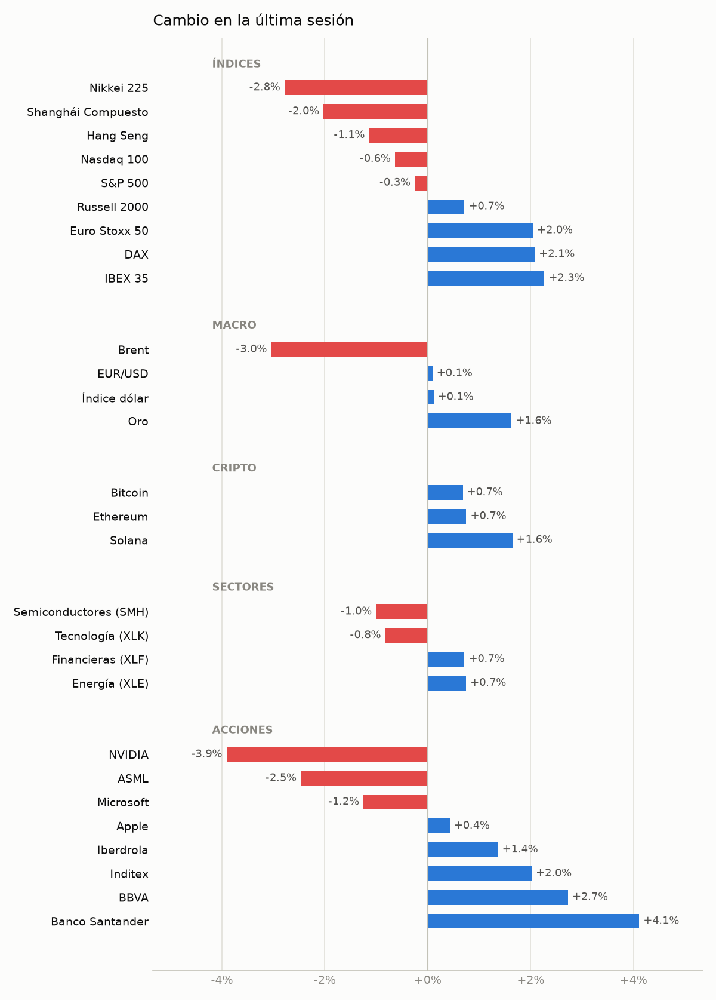

# 📊 Radar de mercados

**lunes 16 nov 2026 · revisión de actualización · 20:59 (Madrid)**

Proyecto de I+D · simulación (paper trading) · no es asesoramiento financiero

> **Clima:** 🔴 risk-off (aversión al riesgo)  
> Desde la revisión anterior (apertura de Europa) Wall Street ha tenido una sesión de ventas lideradas por tecnología y semiconductores (Nasdaq 100 -2,3%, SMH -4,3%, NVDA -4,0%) a la espera de los resultados de Nvidia (17-nov) y la salida a bolsa de Anthropic. Se suman el discurso de Warsh sobre los riesgos de la IA, el informe de estabilidad financiera de la Fed y mensajes de halcones (Hammack, Schmid) que hablan de subidas de tipos; el IPC de octubre se lee como contenido salvo en gasolina. Bitcoin y cripto siguen en sobreventa, el oro en mínimos de 52 semanas y el Brent cae con fuerza.  
> **Decisión:** no operar hoy — Revisión de actualización (solo observación): las decisiones se toman con el cierre de EE. UU. y los resultados de Nvidia son un evento binario pendiente.

| Activo | Último | Día | 1 mes | Tendencia |
|---|--:|--:|--:|---|
| **S&P 500** | 7.426 | 🔴▼ -1.8% | 🔴▼ -3.0% | ➡️ lateral |
| **Nasdaq 100** | 27.291 | 🔴▼ -2.3% | 🔴▼ -6.5% | ↘️ bajista |
| **IBEX 35** | 19.947 | 🔴▼ -0.4% | 🔵▲ +3.2% | ↗️ alcista |
| **Nikkei 225** | 61.142 | 🔵▲ +0.5% | 🔴▼ -9.7% | ↘️ bajista |
| **Bono EE. UU. 10a (%)** | 5.113 | ▼ -4 pb | ▲ +1 pb | ↗️ alcista |
| **EUR/USD** | 1.101 | 🔴▼ -0.4% | 🔴▼ -1.8% | ↘️ bajista |
| **Brent** | 92.41 | 🔴▼ -3.6% | 🔴▼ -15.9% | ↘️ bajista |
| **Oro** | 3.865 | 🔴▼ -0.5% | 🔴▼ -7.6% | ↘️ bajista |
| **Bitcoin** | 64.998 | 🔴▼ -0.5% | 🔴▼ -18.8% | ↘️ bajista |

<picture><source media="(prefers-color-scheme: dark)" srcset="assets/mapa-dark.png"></picture>

## 🕒 Hoy, sesión a sesión

- **09:52 · apertura Europa**  _sin análisis con IA_
- cierre EE. UU. · prevista ~22:15

## 📰 Noticias clave

- **[sectorial]** [Stocks Fall Before Nvidia Earnings, Anthropic IPO: Markets Wrap](https://news.google.com/rss/articles/CBMilAFBVV95cUxOU3BQd2lUam5YX1RGekdqV203U1BmRzNUQnlhem10ajRycVpfTUYzRWtOM2h1ZDd5M2tvUnNXeG1VOHRGTEl4VkJsSUhuQk41UlcyNU1EZDJaSTNTd2NvM3lDUDV5NU95SUtxSHZaZEpjSnMxRGgtamUtb0lYWUtHMTFZZDBLblVaeXhVTEhSa2ZPeF9y?oc=5) Bloomberg.com · 16/11 20:04 · ●●●●●  
  Parcialmente esperada: la cautela previa a Nvidia y a la OPV de Anthropic ya se veía, pero la intensidad de la caída (-2,3% NDX, -4,3% SMH) supera a la de días previos. **Impacto:** Semiconductores y tecnología de gran capitalización (NVDA, ASML, SMH, XLK) bajan por reducción de riesgo antes del evento y por la competencia de liquidez que supone una OPV grande; arrastra a índices y a cripto.
- **[resultados]** [Nvidia Earnings Nov. 17: $109B Expected, Fed Minutes](https://news.google.com/rss/articles/CBMinwFBVV95cUxNWWlYSEFCYjZwdEVMOHZtUEx3aDlpbkpDdlR6Q0lNVjIxdkJKcVZXYk1Bc3lhelFoZXhIVEduWU1rQk1iQXEzdVRtM0ZvRHJuVnFLRFdkMlV4aHl4YlB0TDRzYV9CTVMwOEV2UTFyR3htbF9tRWRxTHo3RlptRkp1UFdLallTVURTOEtGWXB2YTBvWi13bXZnb2lMeG1FYkU?oc=5) shattered.io · 16/11 20:31 · ●●●●●  
  Evento esperado (resultados de Nvidia el 17-nov, con unos 109.000 M$ de ingresos previstos); el riesgo es la reacción, no el dato. **Impacto:** NVDA, SMH, ASML y el conjunto del complejo IA. NVDA ya acumula -27% en un mes y está en sobreventa, lo que deja la reacción más abierta a un rebote si los resultados convencen.
- **[macro]** [Fed’s Warsh Says Staff Are Gaming Out Contingencies on AI Impact](https://news.google.com/rss/articles/CBMitgFBVV95cUxNTUE0U2w2TzBJcDJHS2dWS3k4MEp1MkFQWHVBTi1nNkJvcG9zQlQ4S0JvTU5aLWNScTJVdmdsYnhLaF9DTXczVU1mQ0V2ZGg0WndacERXamttQy1iT0hYUmc1dndPajU3eDRxX2haeVVmaDhrN0dQdFduNHB6eEZyNEItM0lBYkhQcWFWY3JlUFItUGhnZTBqS0tFeS1iWEJUN214bzVPSHB3SjJhVlVRZHdHRGpsQQ?oc=5) Bloomberg.com · 16/11 18:00 · ●●●●  
  Novedad moderada: Warsh dice que el personal de la Fed simula escenarios de la IA (pérdida de empleos, caída bursátil), junto al informe de estabilidad financiera, y alimenta la narrativa de burbuja. **Impacto:** Refuerza la presión sobre tecnología y semis por el riesgo de que la IA decepcione; no cambia por sí mismo la senda de tipos, pues evita hablar del riesgo inflacionista de la IA.
- **[macro]** [Fed’s Hammack Prefers Small Hikes, Sees Risk of Bigger Moves](https://news.google.com/rss/articles/CBMitAFBVV95cUxOa3MwUUp3QjVuS0NGTWhLN0hYZldpQkJHUUZKRDZSRlhvdXJ1d2VXTVk1UkVzZ2swX1N1OWdQM1g1cC10cnMwaTRCRzEtVWNfWHBLdjdYY19wUEpZZERkQl9zVzNsbjVuZ25zQUFsaXFBMnBVX1I1X1pPU01SdEpPZzA1clBJZkx5TjYwV29QUmxHRmxfYW8wdWFLazlLbXVBRk9nUm01aVppdHRtS2RjRHlJeW0?oc=5) Bloomberg.com · 16/11 20:37 · ●●●●  
  Sorpresa relativa: se habla de subidas de tipos (no recortes), con Hammack a favor de subidas pequeñas y graduales y Schmid con 'trabajo por hacer' en inflación; el mercado ya descuenta cierto sesgo restrictivo con el 10 años en 5,1%. **Impacto:** Sostiene el dólar (DXY en máximos de 52 semanas) y presiona a duración, small caps y cripto; el oro cae pese a la inflación por el alza de tipos reales y del dólar.
- **[macro]** [October CPI Shows Inflation Contained Outside of Gas Prices. Here’s What It Means for Interest Rates](https://news.google.com/rss/articles/CBMi0gFBVV95cUxOVU9MaDlnOU5iYXdrVGpVWFl2eHFodzJ2enRBdFJFMEtnSFJZcWtmcUhyaGNJbVlSVVY1SDZCY0QwcVBxeHRQY0hadExLX1RoM1VMU0NIX1ZnV0tDTndqX2RtVXlaM05jR2hLUHpORTJKOHhmWVZoQ29VOGpjZDVRbXpablpBblVtLTFjS2FYZmo0VUM0TmIyc0Z6X0lMVWhCbWdJU3lvdzJnWWdFQldZWXduTFVVTGlkOEh0TFdKaDlkenNZOG1jcGJ1SlZmc3IzMUE?oc=5) Morningstar · 16/11 21:00 · ●●●  
  El IPC de octubre se interpreta como contenido salvo en energía; moderadamente esperado, con el 10 años casi sin cambios (-0,04). **Impacto:** Limita el riesgo de una Fed mucho más agresiva y evita una presión adicional sobre bonos y renta variable; el efecto neto es neutro a ligeramente favorable para financieras y cíclicos.
- **[cripto]** [Crypto Market Loses About $330 Billion in a Week as Bitcoin Slides and Inflation Fears Mount](https://news.google.com/rss/articles/CBMinAFBVV95cUxPcURqM21DTHY1SWV2UllJdkVQUmdPMmxuWE8zc2pJelExVDdIcFhxRG1GMEJrYjVNNXN3c2tXWmZsSFlYVWJPVjQ5cjdHTURleVlBX2JfXy1XWERuSU1zbFpRQ3NraFFEazJWa1J0VU5UTWlPQ252Y1B4akM2SUxfWEtGU3JLRHBheV9lbTZ5Q1gyS1BOSm9MUFptMmk?oc=5) Yahoo Finance · 16/11 17:58 · ●●●  
  Continuación de una venta ya muy extendida: el mercado cripto pierde unos 330.000 M$ en una semana. **Impacto:** BTC, ETH y SOL en sobreventa extrema (RSI 21-26) por tipos altos y aversión al riesgo; el rebote técnico es posible pero sin catalizador claro.

**Divergencias precio-noticia:** El oro cae (-0,5% y mínimos de 52 semanas) pese a titulares de 'inflación de vuelta': domina el dólar fuerte y los tipos reales altos sobre la cobertura inflacionista. · El Brent cae un 3,6% mientras XLE baja solo un 1,7% y el S&P también cae: el petróleo no actúa como refugio ni como señal de crecimiento, y la energía amortigua mejor de lo esperado. · El IBEX y el Euro Stoxx pierden solo un 0,4-0,6% frente a -2,3% del Nasdaq 100: Europa cierra antes de la peor parte de la sesión de EE. UU. y puede recuperar el diferencial al abrir. · El 10 años apenas baja (-0,04) en una jornada claramente risk-off: no hay búsqueda de refugio en bonos, algo coherente con los mensajes sobre subidas de tipos. · Iberdrola cae un 2,4% (-2,7σ) sin titular específico entre los listados: movimiento sin causa identificada.

## 🎯 Hipótesis de hoy

_Revisión de actualización: solo observación. Las hipótesis se registran con precios de cierre de EE. UU. Estas son las registradas en el cierre del 2026-11-12._

| Activo | Idea | Plazo | Objetivo / stop | Prob. | EV neto |
|---|---|--:|--:|--:|--:|
| 🔴▼ **Russell 2000** | Un 10 años por encima del 5% y una Fed con más subidas encarecen la financiación de las small caps, que ya rompen su media de 50 sesiones. | 5 ses. | +3.0% / −2.0% | 40% | -0.1% 👀 |
| 🔵▲ **Solana** | Rebote técnico desde sobreventa extrema (RSI 23, -21% en 1 mes) tras una liquidación de unos 560.000 M$ en cripto. | 7 ses. | +7.0% / −4.0% | 38% | -0.0% 👀 |

Prob.: probabilidad de tocar el objetivo antes que el stop · EV: valor esperado neto de costes · ✅ se opera en simulación (EV ≥ 1% y prob. ≥ 55%) · 👀 solo se mide

## 👀 Valores a vigilar

- **NVIDIA** — Resultados el 17-nov con la acción en mínimos de 52 semanas y sobreventa (RSI 23); reacción asimétrica posible.
- **Semiconductores (SMH)** — Mayor caída del día (-4,3%); marca la confianza en el complejo IA antes de la OPV de Anthropic.
- **Bitcoin** — RSI 24 y soporte en 65.000; el mensaje de la Fed sobre subidas en diciembre condiciona cualquier rebote.
- **Índice dólar** — Máximos de 52 semanas; si el dólar sigue subiendo, presiona al oro y a cripto.
- **Russell 2000** — Hipótesis bajista abierta; vigilar si la caída se acelera con tipos altos.
- **DAX** — en máximos de 52 semanas
- **Shanghái Compuesto** — en mínimos de 52 semanas
- **EUR/USD** — en mínimos de 52 semanas
- **Oro** — en mínimos de 52 semanas
- **Ethereum** — sobreventa (RSI 26)
- **Solana** — sobreventa (RSI 21)
- **Microsoft** — cruza a la baja su media de 50 sesiones
- **Inditex** — en máximos de 52 semanas
- **Iberdrola** — movimiento anómalo hoy (-2.7σ)

## 🧪 Test en vivo: deriva tras resultados

Regla congelada desde el 2026-10-15: comprar al cierre del día siguiente a una reacción a resultados entre el 10% mejor y vender 40 sesiones después. Objetivo: ≥ 1% neto por operación. [Por qué esta regla](reports/pead.md)

Aún sin operaciones cerradas (cada una dura unos 2 meses). Abiertas: 29.

| Empresa | Entrada | Sesiones | Resultado | SPY mismo periodo |
|---|---|--:|--:|--:|
| TTWO | 2026-11-11 | 1/40 | -1.9% | -0.4% |
| FERG | 2026-11-10 | 2/40 | -1.8% | +1.0% |
| CF | 2026-11-06 | 4/40 | +4.6% | +3.0% |
| CPAY | 2026-11-06 | 4/40 | +0.2% | +3.0% |
| TPR | 2026-11-06 | 4/40 | -0.1% | +3.0% |
| VRSK | 2026-11-06 | 4/40 | +0.8% | +3.0% |
| CDW | 2026-11-05 | 5/40 | +9.1% | +3.3% |
| JKHY | 2026-11-05 | 5/40 | -2.3% | +3.3% |
| SWK | 2026-11-05 | 5/40 | -2.0% | +3.3% |
| ZBH | 2026-11-05 | 5/40 | -2.1% | +3.3% |
| FISV | 2026-11-04 | 6/40 | -0.9% | -1.3% |
| IDXX | 2026-11-03 | 7/40 | +3.9% | +0.4% |
| CBOE | 2026-11-02 | 8/40 | +5.6% | +0.7% |
| REGN | 2026-11-02 | 8/40 | -1.0% | +0.7% |
| VLTO | 2026-11-02 | 8/40 | +1.5% | +0.7% |
| CVNA | 2026-10-30 | 9/40 | +3.7% | +0.2% |
| GEN | 2026-10-30 | 9/40 | +1.9% | +0.2% |
| HII | 2026-10-30 | 9/40 | -2.7% | +0.2% |
| NCLH | 2026-10-30 | 9/40 | +2.8% | +0.2% |
| TXT | 2026-10-30 | 9/40 | -1.6% | +0.2% |
| FLEX | 2026-10-29 | 10/40 | -16.1% | -1.6% |
| VRT | 2026-10-29 | 10/40 | -14.8% | -1.6% |
| PNR | 2026-10-28 | 11/40 | +5.9% | -2.0% |
| ALLE | 2026-10-23 | 14/40 | +6.2% | -0.4% |
| BX | 2026-10-23 | 14/40 | +0.5% | -0.4% |
| NDAQ | 2026-10-23 | 14/40 | +5.9% | -0.4% |
| ROP | 2026-10-23 | 14/40 | +9.1% | -0.4% |
| EFX | 2026-10-21 | 16/40 | +6.4% | -2.1% |
| HAS | 2026-10-21 | 16/40 | +6.6% | -2.1% |

## 📈 Tendencias (6 meses)

<picture><source media="(prefers-color-scheme: dark)" srcset="assets/tendencias-dark.png"></picture>

Todos los activos

| Activo | Último | Día | Semana | 1 mes | 3 meses | RSI | Tendencia | Señales |
|---|--:|--:|--:|--:|--:|--:|---|---|
| S&P 500 | 7.426 | 🔴▼ -1.8% | 🔴▼ -1.6% | 🔴▼ -3.0% | 🔴▼ -3.5% | 41 | ➡️ lateral | — |
| Nasdaq 100 | 27.291 | 🔴▼ -2.3% | 🔴▼ -2.2% | 🔴▼ -6.5% | 🔴▼ -7.5% | 38 | ↘️ bajista | — |
| IBEX 35 | 19.947 | 🔴▼ -0.4% | 🔵▲ +1.0% | 🔵▲ +3.2% | 🔵▲ +0.5% | 61 | ↗️ alcista | — |
| Euro Stoxx 50 | 6.348 | 🔴▼ -0.6% | 🔵▲ +0.9% | 🔵▲ +2.3% | 🔴▼ -1.5% | 58 | ↗️ alcista | — |
| Russell 2000 | 2.740 | 🔴▼ -1.8% | 🔴▼ -3.5% | 🔵▲ +0.7% | 🔴▼ -9.2% | 42 | ➡️ lateral | — |
| DAX | 26.599 | 🔴▼ -0.6% | 🔵▲ +1.3% | 🔵▲ +3.8% | 🔵▲ +1.9% | 61 | ↗️ alcista | en máximos de 52 semanas |
| Nikkei 225 | 61.142 | 🔵▲ +0.5% | 🔵▲ +6.5% | 🔴▼ -9.7% | 🔴▼ -8.7% | 43 | ↘️ bajista | — |
| Hang Seng | 23.638 | 🔴▼ -1.5% | 🔴▼ -3.4% | 🔴▼ -2.8% | 🔴▼ -5.9% | 44 | ↘️ bajista | — |
| Shanghái Compuesto | 3.634 | 🔴▼ -0.6% | 🔴▼ -0.4% | 🔴▼ -2.0% | 🔴▼ -8.4% | 40 | ↘️ bajista | en mínimos de 52 semanas |
| Bono EE. UU. 10a (%) | 5.113 | ▼ -4 pb | ▲ +25 pb | ▲ +1 pb | ▲ +41 pb | 57 | ↗️ alcista | — |
| EUR/USD | 1.101 | 🔴▼ -0.4% | 🔴▼ -1.3% | 🔴▼ -1.8% | 🔴▼ -4.9% | 30 | ↘️ bajista | en mínimos de 52 semanas |
| Índice dólar | 103.51 | 🔵▲ +0.1% | 🔵▲ +1.8% | 🔵▲ +1.6% | 🔵▲ +3.9% | 68 | ↗️ alcista | en máximos de 52 semanas |
| Brent | 92.41 | 🔴▼ -3.6% | 🔴▼ -0.2% | 🔴▼ -15.9% | 🔵▲ +1.5% | 37 | ↘️ bajista | — |
| Oro | 3.865 | 🔴▼ -0.5% | 🔴▼ -6.1% | 🔴▼ -7.6% | 🔴▼ -12.6% | 35 | ↘️ bajista | en mínimos de 52 semanas |
| Bitcoin | 64.998 | 🔴▼ -0.5% | 🔴▼ -12.1% | 🔴▼ -18.8% | 🔴▼ -16.8% | 24 | ↘️ bajista | sobreventa (RSI 24) |
| Ethereum | 1.822 | 🔴▼ -0.8% | 🔴▼ -11.4% | 🔴▼ -21.5% | 🔴▼ -27.6% | 26 | ↘️ bajista | sobreventa (RSI 26) |
| Solana | 71.44 | 🔴▼ -1.7% | 🔴▼ -14.3% | 🔴▼ -29.1% | 🔴▼ -30.3% | 21 | ↘️ bajista | sobreventa (RSI 21) |
| Semiconductores (SMH) | 466.02 | 🔴▼ -4.3% | 🔴▼ -4.4% | 🔴▼ -13.7% | 🔴▼ -18.2% | 36 | ↘️ bajista | — |
| Financieras (XLF) | 58.08 | 🔴▼ -1.0% | 🔵▲ +0.2% | 🔵▲ +4.6% | 🔵▲ +0.4% | 57 | ↗️ alcista | — |
| Energía (XLE) | 63.83 | 🔴▼ -1.7% | 🔵▲ +3.1% | 🔴▼ -6.5% | 🔵▲ +0.2% | 45 | ➡️ lateral | — |
| Tecnología (XLK) | 165.38 | 🔴▼ -2.9% | 🔴▼ -3.2% | 🔴▼ -9.9% | 🔴▼ -10.9% | 36 | ↘️ bajista | — |
| NVIDIA | 156.40 | 🔴▼ -4.0% | 🔴▼ -12.5% | 🔴▼ -27.0% | 🔴▼ -28.8% | 23 | ↘️ bajista | en mínimos de 52 semanas, sobreventa (RSI 23) |
| Apple | 352.36 | 🔴▼ -1.1% | 🔵▲ +0.5% | 🔵▲ +2.6% | 🔵▲ +13.7% | 57 | ↗️ alcista | — |
| Microsoft | 519.33 | 🔴▼ -0.9% | 🔴▼ -4.7% | 🔴▼ -1.8% | 🔵▲ +7.8% | 47 | ➡️ lateral | cruza a la baja su media de 50 sesiones |
| ASML | 1.423 | 🔴▼ -4.9% | 🔴▼ -6.0% | 🔴▼ -13.3% | 🔴▼ -21.1% | 37 | ↘️ bajista | — |
| Banco Santander | 11.02 | 🔴▼ -0.6% | 🔴▼ -0.4% | 🔴▼ -8.4% | 🔴▼ -10.4% | 45 | ↘️ bajista | — |
| BBVA | 23.53 | 🔴▼ -0.2% | 🔵▲ +1.0% | 🔵▲ +1.5% | 🔴▼ -4.4% | 56 | ➡️ lateral | — |
| Inditex | 60.30 | 🔵▲ +1.1% | 🔵▲ +1.1% | 🔵▲ +7.9% | 🔵▲ +3.5% | 66 | ↗️ alcista | en máximos de 52 semanas |
| Iberdrola | 23.14 | 🔴▼ -2.4% | 🔵▲ +0.8% | 🔵▲ +6.7% | 🔵▲ +15.5% | 66 | ↗️ alcista | movimiento anómalo hoy (-2.7σ) |

## ✅ Historial de hipótesis

Registradas: **60** · abiertas: **2** · cerradas: **58**
- Acierto (todas): **47%** (IC 95%: 34–59%, n = 58) · retorno neto medio -0.08%
- Acierto (operadas): **0%** (IC 95%: 0–79%, n = 1) · retorno neto medio -0.55%

<picture><source media="(prefers-color-scheme: dark)" srcset="assets/historial-dark.png"></picture>

Registro completo: [`data/dashboard/hipotesis.csv`](data/dashboard/hipotesis.csv)

---

Fuentes y calidad de datos

- Precios: 3 contrastados, 26 sin segunda fuente, 0 dudosos (⚠️, difieren > 0,5%), 0 sin dato.
- Fuentes de precio usadas: Yahoo (29).
- Titulares: Google News · mercados ES: ok (100); Google News · markets: ok (100); Google News · crypto: ok (100); CNBC: ok (30); MarketWatch: ok (10); CoinDesk: ok (25); Expansión: ok (52).
- Análisis: claude-sonnet-5-5.
- Reglas de tendencia: alcista si el precio está sobre sus medias de 50 y 200 sesiones y sube en el mes; bajista al revés; si no, lateral.

Más: [experimento Polymarket 5 min](docs/experimento-polymarket.md) · [informe del backtest](reports/informe.md)
