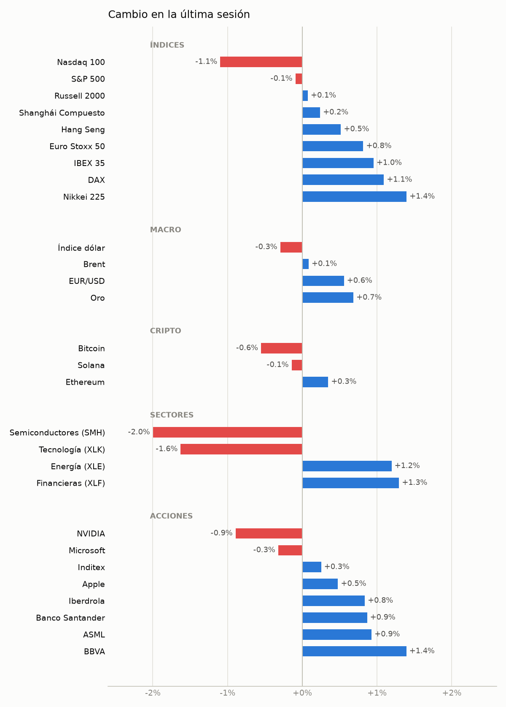
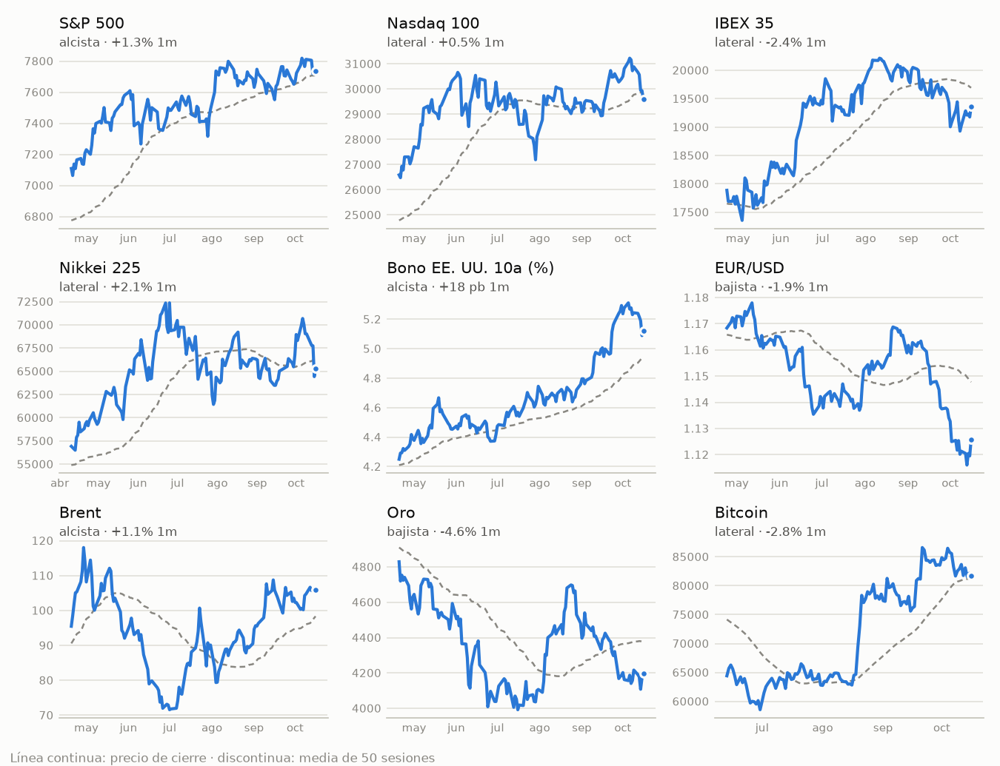

# 📊 Radar de mercados

**viernes 16 oct 2026 · revisión de apertura EE. UU. · 15:52 (Madrid)**

Proyecto de I+D · simulación (paper trading) · no es asesoramiento financiero

> **Clima:** 🟡 mixto  
> Apertura de EE. UU. con futuros planos y cautela. Desde la revisión anterior (cierre de Asia) el mercado sigue digiriendo que Warsh no da pistas de subida de tipos en octubre pese al IPC (3,7%) y el PPI calientes. Europa cierra con subidas (IBEX +1,0%, DAX +1,1%) y la tecnología/semis siguen débiles (SMH -2,0%, XLK -1,6%). Revisión de solo observación, sin hipótesis nuevas.  
> **Decisión:** no operar hoy — Revisión de apertura de EE. UU.: solo observación, las decisiones se toman con los cierres de EE. UU.

| Activo | Último | Día | 1 mes | Tendencia |
|---|--:|--:|--:|---|
| **S&P 500** | 7.737 | 🔴▼ -0.1% | 🔵▲ +1.3% | ↗️ alcista |
| **Nasdaq 100** | 29.607 | 🔴▼ -1.1% | 🔵▲ +0.5% | ➡️ lateral |
| **IBEX 35** | 19.360 | 🔵▲ +1.0% | 🔴▼ -2.4% | ➡️ lateral |
| **Nikkei 225** | 65.324 | 🔵▲ +1.4% | 🔵▲ +2.1% | ➡️ lateral |
| **Bono EE. UU. 10a (%)** | 5.123 | ▲ +3 pb | ▲ +18 pb | ↗️ alcista |
| **EUR/USD** | 1.126 | 🔵▲ +0.6% | 🔴▼ -1.9% | ↘️ bajista |
| **Brent** | 106.01 | 🔵▲ +0.1% | 🔵▲ +1.1% | ↗️ alcista |
| **Oro** | 4.199 | 🔵▲ +0.7% | 🔴▼ -4.6% | ↘️ bajista |
| **Bitcoin** | 81.688 | 🔴▼ -0.6% | 🔴▼ -2.8% | ➡️ lateral |

<picture><source media="(prefers-color-scheme: dark)" srcset="assets/mapa-dark.png"></picture>

## 🕒 Hoy, sesión a sesión

- **02:52 · apertura Asia** 🟡 Apertura de Asia, con datos parciales (Nikkei +1,4% a 16-oct, tras caer un 5,4% en cinco sesiones). Lo nuevo desde la anterior revisión es el cierre de EE. UU. con IPC 3,7% y PPI muy por encima de lo esperado, que mantiene vivas las apuestas de subida de la Fed. Aun así, el bono a 10 años cayó 10 pb y el S&P cerró en máximos. Es una revisión de solo observación.
- **09:51 · apertura Europa** 🟢 Apertura de Europa con subidas moderadas (IBEX +0,6%, Euro Stoxx +0,5%, DAX +0,7%) tras las declaraciones de Warsh, que no dio señales de una subida de tipos en octubre. El dólar cede algo (DXY -0,2%), el Brent cae un 2,9% y el oro rebota un 0,9%. Frente a la revisión anterior, el cambio es que las apuestas de subida de la Fed se moderan, aunque el IPC (3,7%) y el PPI siguen siendo calientes.
- **10:52 · cierre Asia** 🟢 Cierre de Asia con rebote moderado: Nikkei +1,4%, Hang Seng +0,5% y Shanghái +0,2% (en mínimos de 52 semanas), tras la comparecencia de Warsh, que no dio señales de subida de tipos en octubre y se mostró optimista con la IA. Frente a la revisión anterior, las apuestas de subida de la Fed en octubre se moderan, aunque el IPC (3,7%) y el PPI siguen calientes. El BOJ avisa del riesgo de que la inflación supere el 2%, y Indonesia se hunde por la advertencia de rebaja de MSCI.
- **15:52 · apertura EE. UU.** 🟡 Apertura de EE. UU. con futuros planos y cautela. Desde la revisión anterior (cierre de Asia) el mercado sigue digiriendo que Warsh no da pistas de subida de tipos en octubre pese al IPC (3,7%) y el PPI calientes. Europa cierra con subidas (IBEX +1,0%, DAX +1,1%) y la tecnología/semis siguen débiles (SMH -2,0%, XLK -1,6%). Revisión de solo observación, sin hipótesis nuevas.
- cierre Europa · prevista ~17:50
- cierre EE. UU. · prevista ~22:15

## 📰 Noticias clave

- **[macro]** [Markets Like What the Fed’s Warsh Didn’t Say About Inflation](https://news.google.com/rss/articles/CBMigAFBVV95cUxOeExtUFVpZEt4Q3YtVFZsT1FaMGNQd0hqZnhSYnNaNWlSWHdFWFFpZFI0UE5SOERCZzNGbFpDUVJ5ekN1dXlVaEtUNV9DdnNwblV4cGRGQXU1MHFnMWJ2bzdpRVdKVmtFemJfOVVOdTItNmJ5UnEzcTVOeDFBN2JISw?oc=5) Barron's · 16/10 14:03 · ●●●●●  
  Sorpresa moderada: Warsh evita dar guía de tipos tras un IPC caliente, y el mercado lo lee como menos agresivo. **Impacto:** Alivio en bolsas europeas e IBEX, financieras (XLF +1,3%) y cripto; limita la subida del dólar y del bono. Efecto sobre renta variable de EE. UU. aún incierto, con la tecnología débil.
- **[macro]** [Warsh enfría la subida de tipos para octubre en EEUU sin convencer al mercado de deuda](https://news.google.com/rss/articles/CBMi-AFBVV95cUxNdmo1WVN6SGlaU0taaXNpYmpkMDcyUzM3ZE1FV3lFRzB5YmZySEZOX0t2bnVPRlVhVkJuOTU4QTl5X293cUtla0w1TXBMUVFMdW1aZmRPX1hTaUpIb1R4OXBLSk9IUktkS2hGN3pfM1IyV0ptZ3ZDZFFrelpneEdkazd5V09Tb0pIOTBqQXozOGZUSXlLbktSQzg1bWxiNllXdE5lbER3bnhyZ1NDeTBaVjJtX01TWjUxLTV2N3hvQUpuUmhqZ0VBSXFkSDh6VmNmaF9ERlE0X0dzT19yQnkzMzBhdktlOE01bnpGaVE3WmtXVXRueDl0NNIB4wFBVV95cUxOWjkwbC1JSGVlZG5GZGlTbXdhLXphcV9NOF8zbHU3OUZyNkFCd3JzcEdPbVdTVzhCbGdTSmFKU1Z6cC1VaEZhMjRQcUV2d25Dblduc1dPZkFjREhWaEwxNkFWOUNjRGJ3THFRMTdGR0Z6a3BoYzJZbDlQVUxVekUxYWxvRG01bC12a3otc1hEaFpjYk9xMXJfamhEdmN0czM2aU5fMVVkLUVKUk1XOGNZS1VYS0M0bGxtY1R0ZWVkVnhCMnZ6bWNWVWttT1Vocnd4Rmw3MnBRclF3Wlo1bTFKQ0lwbw?oc=5) El Economista · 16/10 14:18 · ●●●●  
  Matiz: se enfría la subida de octubre, pero el mercado de deuda no se convence, así que parte del riesgo sigue descontado. **Impacto:** TNX en 5,12% sigue alto; presión persistente sobre small caps (RUT) y tecnología de larga duración.
- **[macro]** [Inflation jumps to 3.7% as oil prices hit consumers](https://news.google.com/rss/articles/CBMiogFBVV95cUxPbnpmenYtR2J0al9JS2lzSWxuWGpCSWZ6cWZsSERlVzJGT1dQYTVjM1hWT1ZnZ2wwQkxXMkxEU1Uta011c3c0cTRMOUJiSzkxcjd5TzdrLW90Y29sSWFpQXIxcV90ZG9IQ1pMODBQNlh1am52QlBYbzVqNnpRN1g1VFV5bEh4OC1nbTd0aXJsSjM4dmJIX1lIbzB1WmJVdHRiOFE?oc=5) NBC News · 16/10 10:34 · ●●●●  
  IPC de EE. UU. 3,7%, por encima de lo esperado según revisiones previas; ya procesado en el cierre de ayer. **Impacto:** Inflación impulsada por energía: sostiene XLE (máximos de 52 semanas) y Brent (106) y mantiene vivas las apuestas de subida en diciembre.
- **[macro]** [El IBEX sube 0,73 % y supera los 19.300 puntos tras subir el IPC en la eurozona al 3,8 %](https://news.google.com/rss/articles/CBMikwFBVV95cUxONnlaMENRdUtqWnd3MF8wZ2VYVTh3SGRmTDVweGNINGdEYlY0b1ZJLW1jZmhRNHo5bnVMTkE2RmdKbFVUZ1ktM25NeFdycC1zampnRkgzRm9BTE1ObXk5V2pHR0Zqb1BBandSbDA1bzNKLXNjeERoeEc1aHRXbGdYTjU3ZVRjbEk0WFhRUmNtTGpjRjg?oc=5) ABC · 16/10 13:21 · ●●●  
  IPC de la eurozona al 3,8%, dato caliente, pero el IBEX sube igualmente por el tono de Warsh. **Impacto:** Eleva la probabilidad de un BCE más duro y favorece a la banca (SAN, BBVA +0,9/+1,4%); riesgo para el EUR si el BCE no reacciona.
- **[sectorial]** [El rally de la IA flaquea y el foco de la bolsa se desplaza a los resultados empresariales](https://news.google.com/rss/articles/CBMi3wFBVV95cUxPa0VYdnZRemg3OTVQSVBlN3VnMHJzRG1pbHFrLWo2b21hdmZybVl3UnJJQnJNVVlGV2tjTjBNMHdTMzZZaldDX0VXZ3hVajdTQW9iX2tKWVhaYjc4Ni14Qmw0bHM4Q3d4QWdRTXdVUUpGcndab0h3U2xiQ2dzX0lVX25yVHNlM1MyQnRaZnBISGpJOHJabXhLQVJBSVpzTGlHRXlaUmJKcUl0a1J0MHhKVWdNYzJlQmxXbXNiX0JoVUNOMXd5MGtmU0FKNEFmWHgxd1VCTFJ1aElHZEY2MDVn?oc=5) MarketScreener España · 16/10 12:11 · ●●●  
  Continuación: el rally de IA flaquea y el foco pasa a los resultados. **Impacto:** Presión sobre semis (SMH -9,2% en 5 días), NVDA y ASML; si se cumple, la tecnología sigue lastrando el Nasdaq.
- **[geopolítica]** [Stocks Up Pre-Bell as Traders Parse President Trump's Latest Comments on Iran War](https://news.google.com/rss/articles/CBMimgFBVV95cUxOSnYtcmdITHA5Znlnb0N6d2I0WkJLejNkWVgtU1puSm54bDNNV2pjUllPanpwcVJma09XemFmNDFSWG1VaFdUS2F2SW1KVjBCdGNtbmptRDA1MmFWMHI2WlFIWjVFS3pkWU1YZTc0aDZpN1BlMDZVRnN0cFdRUmM0RTBOemlOSHF6YTJnNGE0bzZDbDc0cFFOOWZR?oc=5) Yahoo Finance · 16/10 14:02 · ●●●  
  Nuevos comentarios de Trump sobre la guerra con Irán; el petróleo se modera pero sigue elevado. **Impacto:** Un descenso del Brent restaría apoyo a XLE y a la inflación energética; efecto contrario si hay escalada.

**Divergencias precio-noticia:** Europa sube con IPC de la eurozona en 3,8% y el IBEX en +1,0%: el mercado prioriza el tono de Warsh sobre el dato. · El S&P casi plano (-0,1%) mientras XLF +1,3% y XLE +1,2% suben y XLK -1,6% y SMH -2,0% caen: rotación sectorial, no un risk-on genérico. · El dólar cede (-0,3%) en máximos de 52 semanas pese a una Fed con riesgo de subida: refleja el alivio por la falta de guía de tipos. · El oro sube (+0,7%) con inflación alta y un dólar algo más débil, aunque la tendencia sigue bajista.

## 🎯 Hipótesis de hoy

_Revisión de apertura EE. UU.: solo observación. Las hipótesis se registran con precios de cierre de EE. UU._

## 👀 Valores a vigilar

- **Semiconductores (SMH)** — Su caída de -9,2% en 5 días contrasta con un S&P estable; un rebote o una nueva ruptura marcará el tono tecnológico al cierre.
- **Energía (XLE)** — En máximos de 52 semanas; depende de que el Brent no se debilite más tras las declaraciones sobre Irán.
- **Índice dólar** — En máximos de 52 semanas pero cede hoy; vigilar si cierra por debajo de la sesión anterior.
- **Russell 2000** — Índice bajista sensible al rendimiento del bono (TNX 5,12%).
- **Shanghái Compuesto** — En mínimos de 52 semanas y sobreventa (RSI 28), posible rebote técnico.
- **Nasdaq 100** — cruza a la baja su media de 50 sesiones
- **EUR/USD** — en mínimos de 52 semanas
- **Apple** — en máximos de 52 semanas
- **Iberdrola** — en máximos de 52 semanas, sobrecompra (RSI 71)

## 🧪 Test en vivo: deriva tras resultados

Regla congelada desde el 2026-10-15: comprar al cierre del día siguiente a una reacción a resultados entre el 10% mejor y vender 40 sesiones después. Objetivo: ≥ 1% neto por operación. [Por qué esta regla](reports/pead.md)

Aún sin operaciones cerradas (cada una dura unos 2 meses). Abiertas: 0.

## 📈 Tendencias (6 meses)

<picture><source media="(prefers-color-scheme: dark)" srcset="assets/tendencias-dark.png"></picture>

Todos los activos

| Activo | Último | Día | Semana | 1 mes | 3 meses | RSI | Tendencia | Señales |
|---|--:|--:|--:|--:|--:|--:|---|---|
| S&P 500 | 7.737 | 🔴▼ -0.1% | 🔴▼ -1.0% | 🔵▲ +1.3% | 🔵▲ +3.9% | 51 | ↗️ alcista | — |
| Nasdaq 100 | 29.607 | 🔴▼ -1.1% | 🔴▼ -4.1% | 🔵▲ +0.5% | 🔵▲ +3.5% | 40 | ➡️ lateral | cruza a la baja su media de 50 sesiones |
| IBEX 35 | 19.360 | 🔵▲ +1.0% | 🔵▲ +1.7% | 🔴▼ -2.4% | 🔴▼ -0.1% | 49 | ➡️ lateral | — |
| Euro Stoxx 50 | 6.219 | 🔵▲ +0.8% | 🔵▲ +0.7% | 🔴▼ -1.7% | 🔴▼ -1.1% | 47 | ➡️ lateral | — |
| Russell 2000 | 2.769 | 🔵▲ +0.1% | 🔴▼ -1.3% | 🔴▼ -3.7% | 🔴▼ -5.9% | 38 | ↘️ bajista | — |
| DAX | 25.660 | 🔵▲ +1.1% | 🔵▲ +2.3% | 🔴▼ -0.2% | 🔵▲ +2.6% | 56 | ➡️ lateral | — |
| Nikkei 225 | 65.324 | 🔵▲ +1.4% | 🔴▼ -5.4% | 🔵▲ +2.1% | 🔴▼ -2.9% | 44 | ➡️ lateral | — |
| Hang Seng | 24.187 | 🔵▲ +0.5% | 🔴▼ -0.1% | 🔴▼ -2.1% | 🔴▼ -3.8% | 43 | ↘️ bajista | — |
| Shanghái Compuesto | 3.716 | 🔵▲ +0.2% | 🔴▼ -2.6% | 🔴▼ -6.0% | 🔴▼ -5.0% | 28 | ↘️ bajista | en mínimos de 52 semanas, sobreventa (RSI 28) |
| Bono EE. UU. 10a (%) | 5.123 | ▲ +3 pb | ▼ -12 pb | ▲ +18 pb | ▲ +53 pb | 51 | ↗️ alcista | — |
| EUR/USD | 1.126 | 🔵▲ +0.6% | 🔵▲ +0.4% | 🔴▼ -1.9% | 🔴▼ -1.4% | 40 | ↘️ bajista | en mínimos de 52 semanas |
| Índice dólar | 101.70 | 🔴▼ -0.3% | 🔴▼ -0.5% | 🔵▲ +1.5% | 🔵▲ +0.7% | 54 | ↗️ alcista | en máximos de 52 semanas |
| Brent | 106.01 | 🔵▲ +0.1% | 🔵▲ +1.2% | 🔵▲ +1.1% | 🔵▲ +18.8% | 59 | ↗️ alcista | — |
| Oro | 4.199 | 🔵▲ +0.7% | 🔴▼ -0.4% | 🔴▼ -4.6% | 🔵▲ +4.5% | 45 | ↘️ bajista | — |
| Bitcoin | 81.688 | 🔴▼ -0.6% | 🔴▼ -2.4% | 🔴▼ -2.8% | 🔵▲ +29.7% | 47 | ➡️ lateral | — |
| Ethereum | 2.449 | 🔵▲ +0.3% | 🔴▼ -3.4% | 🔴▼ -9.0% | 🔵▲ +30.2% | 41 | ➡️ lateral | — |
| Solana | 105.18 | 🔴▼ -0.1% | 🔴▼ -5.4% | 🔴▼ -13.8% | 🔵▲ +39.6% | 40 | ➡️ lateral | — |
| Semiconductores (SMH) | 547.67 | 🔴▼ -2.0% | 🔴▼ -9.2% | 🔴▼ -2.3% | 🔴▼ -2.0% | 33 | ➡️ lateral | — |
| Financieras (XLF) | 55.99 | 🔵▲ +1.3% | 🔵▲ +2.3% | 🔵▲ +0.2% | 🔴▼ -0.1% | 59 | ➡️ lateral | — |
| Energía (XLE) | 67.36 | 🔵▲ +1.2% | 🔵▲ +3.5% | 🔵▲ +4.5% | 🔵▲ +16.2% | 66 | ↗️ alcista | en máximos de 52 semanas |
| Tecnología (XLK) | 186.11 | 🔴▼ -1.6% | 🔴▼ -6.4% | 🔴▼ -1.0% | 🔵▲ +5.9% | 37 | ➡️ lateral | — |
| NVIDIA | 215.29 | 🔴▼ -0.9% | 🔴▼ -6.1% | 🔴▼ -1.8% | 🔵▲ +5.9% | 38 | ➡️ lateral | — |
| Apple | 343.63 | 🔵▲ +0.5% | 🔵▲ +2.1% | 🔵▲ +2.0% | 🔵▲ +5.2% | 62 | ↗️ alcista | en máximos de 52 semanas |
| Microsoft | 537.70 | 🔴▼ -0.3% | 🔵▲ +0.5% | 🔵▲ +8.0% | 🔵▲ +33.7% | 64 | ↗️ alcista | — |
| ASML | 1.673 | 🔵▲ +0.9% | 🔴▼ -6.0% | 🔵▲ +2.6% | 🔴▼ -3.8% | 41 | ➡️ lateral | — |
| Banco Santander | 12.10 | 🔵▲ +0.9% | 🔵▲ +0.7% | 🔴▼ -6.6% | 🔵▲ +1.6% | 45 | ➡️ lateral | — |
| BBVA | 23.31 | 🔵▲ +1.4% | 🔵▲ +0.9% | 🔴▼ -7.3% | 🔵▲ +3.3% | 40 | ➡️ lateral | — |
| Inditex | 55.58 | 🔵▲ +0.3% | 🔵▲ +3.2% | 🔵▲ +6.1% | 🔵▲ +2.7% | 61 | ↗️ alcista | — |
| Iberdrola | 21.71 | 🔵▲ +0.8% | 🔵▲ +2.1% | 🔵▲ +5.8% | 🔵▲ +1.8% | 71 | ↗️ alcista | en máximos de 52 semanas, sobrecompra (RSI 71) |

## ✅ Historial de hipótesis

Registradas: **7** · abiertas: **6** · cerradas: **1**
- Acierto (todas): **0%** (IC 95%: 0–79%, n = 1) · retorno neto medio -0.58%

Fase 0 (rodaje): con menos de 30 hipótesis cerradas el acierto no es estadísticamente informativo.

Registro completo: [`data/dashboard/hipotesis.csv`](data/dashboard/hipotesis.csv)

---

Fuentes y calidad de datos

- Precios: 3 contrastados, 26 sin segunda fuente, 0 dudosos (⚠️, difieren > 0,5%), 0 sin dato.
- Fuentes de precio usadas: Yahoo (29).
- Titulares: Google News · mercados ES: ok (100); Google News · markets: ok (100); Google News · crypto: ok (100); CNBC: ok (30); MarketWatch: ok (10); CoinDesk: ok (25); Expansión: ok (51).
- Análisis: claude-sonnet-5-5.
- Reglas de tendencia: alcista si el precio está sobre sus medias de 50 y 200 sesiones y sube en el mes; bajista al revés; si no, lateral.

Más: [experimento Polymarket 5 min](docs/experimento-polymarket.md) · [informe del backtest](reports/informe.md)
