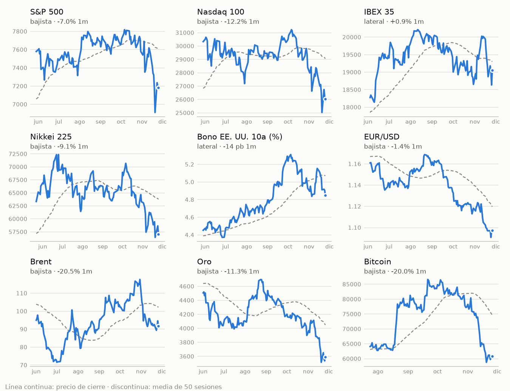

# 📊 Radar de mercados

**viernes 27 nov 2026 · revisión de apertura Europa · 09:52 (Madrid)**

Proyecto de I+D · simulación (paper trading) · no es asesoramiento financiero

> **Clima:** 🟡 mixto  
> En la apertura de Europa dominan las sorpresas a la baja de inflación en Francia y España (energía), el repunte de Asia liderado por China (+3,7%, +4,6σ) tras promesas de apoyo al mercado, y un Tokio con inflación alta que refuerza una subida del BoJ. Los precios de EE. UU. son de cierre del 25-nov, así que no reflejan aún lo ocurrido el 26-27; el oro (+4,7%) sube de forma anómala pese al sesgo restrictivo de la Fed.  
> **Decisión:** no operar hoy — Revisión de apertura de Europa: solo observación, sin hipótesis nuevas.

| Activo | Último | Día | 1 mes | Tendencia |
|---|--:|--:|--:|---|
| **S&P 500** | 7.183 | 🔴▼ -0.3% | 🔴▼ -7.0% | ↘️ bajista |
| **Nasdaq 100** | 26.047 | 🔴▼ -0.6% | 🔴▼ -12.2% | ↘️ bajista |
| **IBEX 35** | 19.212 | 🔵▲ +0.8% | 🔵▲ +1.9% | ➡️ lateral |
| **Nikkei 225** | 58.711 | 🔵▲ +2.1% | 🔴▼ -7.2% | ↘️ bajista |
| **Bono EE. UU. 10a (%)** | 4.848 | ▼ -6 pb | ▼ -14 pb | ➡️ lateral |
| **EUR/USD** | 1.097 | 🔴▼ -0.0% | 🔴▼ -1.7% | ↘️ bajista |
| **Brent** | 92.26 | 🔴▼ -2.5% | 🔴▼ -20.0% | ↘️ bajista |
| **Oro** | 3.702 | 🔵▲ +4.7% | 🔴▼ -8.6% | ↘️ bajista |
| **Bitcoin** | 61.702 | 🔵▲ +2.0% | 🔴▼ -18.5% | ↘️ bajista |

<picture><source media="(prefers-color-scheme: dark)" srcset="assets/mapa-dark.png"></picture>

## 🕒 Hoy, sesión a sesión

- **09:52 · apertura Europa** 🟡 En la apertura de Europa dominan las sorpresas a la baja de inflación en Francia y España (energía), el repunte de Asia liderado por China (+3,7%, +4,6σ) tras promesas de apoyo al mercado, y un Tokio con inflación alta que refuerza una subida del BoJ. Los precios de EE. UU. son de cierre del 25-nov, así que no reflejan aún lo ocurrido el 26-27; el oro (+4,7%) sube de forma anómala pese al sesgo restrictivo de la Fed.
- cierre EE. UU. · prevista ~22:15

## 📰 Noticias clave

- **[macro]** [Hawkish Fed poised to raise rates despite stock market turmoil](https://news.google.com/rss/articles/CBMihAFBVV95cUxNREd0RUx1TTJiVHRreUdrdTRYNk5HdVNmMFp4SURfa3c2S1NmalFseWJ5VnZqWkxJZ1gzR1FtZkNjZnJWRzRrU05hNUJCYVhOdGk2RzJRU1NiTVRnYXd4bThxWlhZSmpsMzlGMXZGc0lPaFo3R0FydU5fYkc0Y1c1U0pzSUY?oc=5) Financial Times · 26/11 15:58 · ●●●●●  
  Esperada en parte: la Fed hawkish se prepara para subir tipos pese a la tensión bursátil. **Impacto:** Presión sobre tecnología de larga duración y semiconductores; sostiene el dólar (máximos de 52 semanas) y limita al euro.
- **[macro]** [French Inflation Slows Much More Than Expected as Energy Eases](https://news.google.com/rss/articles/CBMiswFBVV95cUxNaWtKYU1TZnA1TVgwWFdBUXFfcWkzdzBjbDZWYlU0U21EOHEzdFNPaHJCbVBWQTUxV0JWNTRKTGRqZUZJSWdRdVZPUl9nYll6R1VWaDBiTXRLdC1YMHFvbDEtcDZDZV9sREhfbG9HOEo2NE1tX1JBQjhQS1BDLVUyeTZVTXlpSHdlVWxoRm1zbzZJWVZoeWdOSnBQc2ZaVG1LMXQ0LXFUUzFDMDZHQmJUOHJSTQ?oc=5) Bloomberg.com · 27/11 09:00 · ●●●●  
  Sorpresa: la inflación francesa se enfría mucho más de lo esperado (cifras dispares entre fuentes: 2,9% y 3,2%) por la energía. **Impacto:** Alivia la presión sobre el BCE y apoya a bolsas europeas y al consumo; presiona algo al euro. Dato de IPC francés dispar entre titulares, hay que verificarlo.
- **[política/regulación]** [China stocks surge most in two years as Beijing vows stronger market support](https://news.google.com/rss/articles/CBMilwFBVV95cUxONGNXdUhLb3NNTUhsbjNxMjUxeno3cGNlVU5LbThqU09QLTJxQ2lRemYxREtuMFlhVnlRMXVDOHZKdkZWRDVUc053Mng0VFFrRjREdnBEOUZlWTd6cGZLQmJZeHNqRVRIMXpqbTlPRGFTclFIWUNxcV9EVGNJeEU1UGNWc1RkZEhfV3VPOWp4WG5MNWswNTRJ?oc=5) Yahoo Finance · 27/11 09:10 · ●●●●  
  Sorpresa: Pekín promete más apoyo al mercado y las acciones chinas suben lo máximo en dos años. **Impacto:** Shanghái y Hang Seng al alza; arrastre a materias primas y a bolsas asiáticas. Un movimiento de +4,6σ suele estar en gran parte descontado a corto plazo.
- **[macro]** [Spain's 12-month EU-harmonised inflation falls to 4.1% in November](https://news.google.com/rss/articles/CBMirAFBVV95cUxObXhfaWZjV2tnUWppbUhLQUg1eFZFc2V0cnVIelk1Q0Uwd3NpMG9DU0dWTUFnenR6aGNNa3k4TU5RelVlTkZKVFphLS1GQ0c2M0NjYUctc0RPWHp6Y1N5RGRNQy1nb05LQlVsWWQ0ZGpvMVRrT3ZyVHhwc2dveWNVWkEtb3JOZU9PWFFSUlF2Q2lHSDJZU3M1N0xaX0VzdVBxNEtsSWxVY3U5dl9P?oc=5) Reuters · 27/11 09:05 · ●●●  
  Sorpresa moderada: la inflación armonizada española baja al 4,1% por los carburantes, aunque sigue alta. **Impacto:** Favorece al IBEX y a consumo; el Santander (+3,0%) ya reacciona, pero la inflación sigue alta y limita el recorte de tipos.
- **[macro]** [Tokyo core inflation at 16-month high, bolsters case for BOJ hike](https://news.google.com/rss/articles/CBMioAFBVV95cUxNbUU2UTdMSzhabVJEYUYzN1Y1SGk3MWdLeVo4cV9iWDVCd3RZWDVDR2lFZ0dtUTRlUUxxbExIRlJDeGx3dEVVLVBuRU1qaDlrXzd6aHpwUHVWTEhMemE2ZzdaSjROTy1HQUF2dkdDcFhNYWtnMU51a2dsSURKSmlfdjlkTnMzeDdySmZLbWotTnR2clUxR0hrQ255ekNnM3dR?oc=5) Reuters · 27/11 00:42 · ●●●  
  Inflación subyacente de Tokio en máximos de 16 meses: refuerza la subida del BoJ en diciembre. **Impacto:** Apoya al yen y sube los rendimientos de los JGB; riesgo para el Nikkei si el yen se aprecia. USDJPY sostenido sobre 159.
- **[geopolítica]** [Two Italians killed in Kuwait drone attack; Trump says Iran war ends ‘whenever I want it’](https://www.cnbc.com/2026/11/27/us-iran-war-trump-hormuz-italian-killed-trump.html) CNBC · 27/11 04:30 · ●●●  
  Continúa el conflicto con Irán: ataque con drones en Kuwait y Trump dice que la guerra termina 'cuando quiera'. **Impacto:** Prima de riesgo en crudo, pero el Brent cae un 2,5% y un -20% en un mes, lo que sugiere que el mercado descuenta una desescalada.

**Divergencias precio-noticia:** El oro sube un 4,7% (+3σ) con dólar en máximos y Fed hawkish, algo atípico; no hay un titular claro que lo explique (id 17 habla de 'estabilidad'). · El Brent baja un 2,5% pese a ataques con drones en Kuwait: el mercado parece ignorar el riesgo geopolítico y centrarse en la demanda y la desescalada. · Las bolsas de EE. UU. muestran el cierre del 25-nov y no reflejan 26-27, por lo que la comparación con Asia y Europa es incompleta. · Cripto rebota (+2-3%) con ETF de bitcoin en salidas récord y el sesgo hawkish; parece rebote técnico, no un cambio de fondo.

## 🎯 Hipótesis de hoy

_Revisión de apertura Europa: solo observación. Las hipótesis se registran con precios de cierre de EE. UU. Estas son las registradas en el cierre del 2026-11-25._

| Activo | Idea | Plazo | Objetivo / stop | Prob. | EV neto |
|---|---|--:|--:|--:|--:|
| 🔵▲ **Hang Seng** | Rebote desde sobreventa (RSI 27, mínimos de 52 semanas) con alivio arancelario ya visible en Asia y Europa, que aún no está del todo en el último precio de la tabla. | 5 ses. | +3.0% / −2.0% | 44% | +0.1% 👀 |
| 🔴▼ **Energía (XLE)** | El Brent cae un 3% el día 26 con EE. UU. cerrado, y XLE no lo ha reflejado; se espera un ajuste a la baja en la reapertura dentro de una tendencia bajista del crudo (-20% en 1 mes). | 3 ses. | +2.5% / −1.6% | 47% | +0.2% 👀 |
| 🔴▼ **NVIDIA** | El aviso de S&P sobre el rating, publicado tras el cierre de EE. UU., aún no está en el precio; la reapertura puede reflejarlo sumado a la presión sobre semiconductores y al sesgo restrictivo de la Fed. | 3 ses. | +8.0% / −5.0% | 40% | +0.1% 👀 |

Prob.: probabilidad de tocar el objetivo antes que el stop · EV: valor esperado neto de costes · ✅ se opera en simulación (EV ≥ 1% y prob. ≥ 55%) · 👀 solo se mide

## 👀 Valores a vigilar

- **Shanghái Compuesto** — Movimiento anómalo de +4,6σ: ver si hay continuidad o reversión tras las promesas de apoyo.
- **Oro** — Subida anómala de +3σ sin catalizador claro frente a un dólar fuerte y una Fed restrictiva.
- **Nasdaq 100** — Su cierre de EE. UU. reflejará la Fed hawkish y la volatilidad de la IA; hipótesis bajista abierta.
- **Banco Santander** — Sube un 3% con la inflación a la baja; ver si se mantiene al cierre europeo.
- **Brent** — Cae un 2,5% con riesgo en Irán; clave para XLE y la inflación.
- **EUR/USD** — en mínimos de 52 semanas
- **Índice dólar** — en máximos de 52 semanas
- **Apple** — en máximos de 52 semanas

## 🧪 Test en vivo: deriva tras resultados

Regla congelada desde el 2026-10-15: comprar al cierre del día siguiente a una reacción a resultados entre el 10% mejor y vender 40 sesiones después. Objetivo: ≥ 1% neto por operación. [Por qué esta regla](reports/pead.md)

Aún sin operaciones cerradas (cada una dura unos 2 meses). Abiertas: 34.

**Se compran en la próxima sesión:** HPQ (reacción +11.8%)

| Empresa | Entrada | Sesiones | Resultado | SPY mismo periodo |
|---|---|--:|--:|--:|
| DLTR | 2026-11-25 | 0/40 | +0.0% | +0.0% |
| PANW | 2026-11-20 | 3/40 | +3.7% | +3.9% |
| TJX | 2026-11-19 | 4/40 | +4.8% | +0.1% |
| TSN | 2026-11-17 | 6/40 | -0.2% | -2.1% |
| TTWO | 2026-11-11 | 10/40 | -1.7% | -5.7% |
| FERG | 2026-11-10 | 11/40 | -0.9% | -4.4% |
| CF | 2026-11-06 | 13/40 | -1.6% | -2.5% |
| CPAY | 2026-11-06 | 13/40 | -0.2% | -2.5% |
| TPR | 2026-11-06 | 13/40 | -2.4% | -2.5% |
| VRSK | 2026-11-06 | 13/40 | +0.1% | -2.5% |
| CDW | 2026-11-05 | 14/40 | +10.5% | -2.2% |
| JKHY | 2026-11-05 | 14/40 | +1.0% | -2.2% |
| SWK | 2026-11-05 | 14/40 | -5.2% | -2.2% |
| ZBH | 2026-11-05 | 14/40 | +3.0% | -2.2% |
| FISV | 2026-11-04 | 15/40 | -3.7% | -6.5% |
| IDXX | 2026-11-03 | 16/40 | +5.6% | -5.0% |
| CBOE | 2026-11-02 | 17/40 | +0.7% | -4.7% |
| REGN | 2026-11-02 | 17/40 | +2.1% | -4.7% |
| VLTO | 2026-11-02 | 17/40 | +3.9% | -4.7% |
| CVNA | 2026-10-30 | 18/40 | -0.7% | -5.2% |
| GEN | 2026-10-30 | 18/40 | +3.6% | -5.2% |
| HII | 2026-10-30 | 18/40 | -5.5% | -5.2% |
| NCLH | 2026-10-30 | 18/40 | -3.2% | -5.2% |
| TXT | 2026-10-30 | 18/40 | -5.6% | -5.2% |
| FLEX | 2026-10-29 | 19/40 | -27.8% | -6.8% |
| LH | 2026-10-29 | 19/40 | +0.4% | -6.8% |
| VRT | 2026-10-29 | 19/40 | -29.5% | -6.8% |
| PNR | 2026-10-28 | 20/40 | +13.2% | -7.2% |
| ALLE | 2026-10-23 | 23/40 | +7.4% | -5.7% |
| BX | 2026-10-23 | 23/40 | +0.8% | -5.7% |
| NDAQ | 2026-10-23 | 23/40 | +4.4% | -5.7% |
| ROP | 2026-10-23 | 23/40 | +10.3% | -5.7% |
| EFX | 2026-10-21 | 25/40 | +5.8% | -7.3% |
| HAS | 2026-10-21 | 25/40 | -3.0% | -7.3% |

## 📈 Tendencias (6 meses)

<picture><source media="(prefers-color-scheme: dark)" srcset="assets/tendencias-dark.png"></picture>

Todos los activos

| Activo | Último | Día | Semana | 1 mes | 3 meses | RSI | Tendencia | Señales |
|---|--:|--:|--:|--:|--:|--:|---|---|
| S&P 500 | 7.183 | 🔴▼ -0.3% | 🔴▼ -1.9% | 🔴▼ -7.0% | 🔴▼ -7.1% | 40 | ↘️ bajista | — |
| Nasdaq 100 | 26.047 | 🔴▼ -0.6% | 🔴▼ -3.9% | 🔴▼ -12.2% | 🔴▼ -12.1% | 38 | ↘️ bajista | — |
| IBEX 35 | 19.212 | 🔵▲ +0.8% | 🔵▲ +1.8% | 🔵▲ +1.9% | 🔴▼ -3.1% | 49 | ➡️ lateral | — |
| Euro Stoxx 50 | 6.078 | 🔵▲ +1.1% | 🔵▲ +2.3% | 🔴▼ -2.1% | 🔴▼ -4.6% | 46 | ↘️ bajista | — |
| Russell 2000 | 2.704 | 🔵▲ +0.7% | 🔴▼ -0.4% | 🔴▼ -4.1% | 🔴▼ -10.3% | 45 | ↘️ bajista | — |
| DAX | 25.415 | 🔵▲ +0.8% | 🔵▲ +2.5% | 🔴▼ -2.4% | 🔴▼ -2.1% | 47 | ➡️ lateral | — |
| Nikkei 225 | 58.711 | 🔵▲ +2.1% | 🔴▼ -1.2% | 🔴▼ -7.2% | 🔴▼ -10.4% | 43 | ↘️ bajista | — |
| Hang Seng | 22.695 | 🔵▲ +2.1% | 🔵▲ +1.3% | 🔴▼ -1.1% | 🔴▼ -11.3% | 41 | ↘️ bajista | — |
| Shanghái Compuesto | 3.606 | 🔵▲ +3.7% | 🔵▲ +2.1% | 🔴▼ -1.2% | 🔴▼ -7.1% | 48 | ↘️ bajista | movimiento anómalo hoy (+4.6σ) |
| Bono EE. UU. 10a (%) | 4.848 | ▼ -6 pb | ▼ -22 pb | ▼ -14 pb | ▲ +18 pb | 37 | ➡️ lateral | — |
| EUR/USD | 1.097 | 🔴▼ -0.0% | 🔴▼ -0.0% | 🔴▼ -1.7% | 🔴▼ -5.6% | 34 | ↘️ bajista | en mínimos de 52 semanas |
| Índice dólar | 103.81 | 🔵▲ +0.1% | 🔴▼ -0.1% | 🔵▲ +1.6% | 🔵▲ +4.1% | 63 | ↗️ alcista | en máximos de 52 semanas |
| Brent | 92.26 | 🔴▼ -2.5% | 🔵▲ +0.3% | 🔴▼ -20.0% | 🔵▲ +3.3% | 41 | ↘️ bajista | — |
| Oro | 3.702 | 🔵▲ +4.7% | 🔵▲ +0.5% | 🔴▼ -8.6% | 🔴▼ -18.3% | 41 | ↘️ bajista | movimiento anómalo hoy (+3.0σ) |
| Bitcoin | 61.702 | 🔵▲ +2.0% | 🔵▲ +0.9% | 🔴▼ -18.5% | 🔴▼ -26.6% | 33 | ↘️ bajista | — |
| Ethereum | 1.730 | 🔵▲ +2.5% | 🔵▲ +0.5% | 🔴▼ -22.6% | 🔴▼ -35.7% | 34 | ↘️ bajista | — |
| Solana | 73.27 | 🔵▲ +3.3% | 🔵▲ +3.8% | 🔴▼ -18.6% | 🔴▼ -39.9% | 38 | ↘️ bajista | — |
| Semiconductores (SMH) | 422.46 | 🔴▼ -1.0% | 🔴▼ -8.1% | 🔴▼ -24.3% | 🔴▼ -26.3% | 37 | ↘️ bajista | — |
| Financieras (XLF) | 56.51 | 🔵▲ +0.7% | 🔵▲ +0.2% | 🔵▲ +1.1% | 🔴▼ -2.4% | 49 | ↗️ alcista | — |
| Energía (XLE) | 60.90 | 🔵▲ +0.7% | 🔴▼ -0.6% | 🔴▼ -10.7% | 🔴▼ -2.2% | 39 | ➡️ lateral | — |
| Tecnología (XLK) | 155.79 | 🔴▼ -0.8% | 🔴▼ -4.9% | 🔴▼ -17.8% | 🔴▼ -17.4% | 37 | ↘️ bajista | — |
| NVIDIA | 149.30 | 🔴▼ -3.9% | 🔴▼ -1.1% | 🔴▼ -31.5% | 🔴▼ -34.5% | 37 | ↘️ bajista | — |
| Apple | 355.58 | 🔵▲ +0.4% | 🔵▲ +0.9% | 🔵▲ +2.4% | 🔵▲ +13.0% | 58 | ↗️ alcista | en máximos de 52 semanas |
| Microsoft | 489.93 | 🔴▼ -1.2% | 🔴▼ -3.6% | 🔴▼ -7.8% | 🔴▼ -3.0% | 39 | ➡️ lateral | — |
| ASML | 1.303 | 🔴▼ -2.5% | 🔴▼ -6.6% | 🔴▼ -20.3% | 🔴▼ -24.9% | 36 | ↘️ bajista | — |
| Banco Santander | 10.75 | 🔵▲ +3.0% | 🔵▲ +4.2% | 🔵▲ +2.3% | 🔴▼ -14.5% | 48 | ➡️ lateral | — |
| BBVA | 22.03 | 🔵▲ +0.8% | 🔵▲ +0.9% | 🔵▲ +0.7% | 🔴▼ -11.4% | 44 | ➡️ lateral | — |
| Inditex | 58.26 | 🔴▼ -0.6% | 🔵▲ +0.8% | 🔵▲ +3.5% | 🔵▲ +1.3% | 51 | ↗️ alcista | — |
| Iberdrola | 22.95 | 🔴▼ -0.3% | 🔵▲ +1.2% | 🔵▲ +3.8% | 🔵▲ +15.4% | 59 | ↗️ alcista | — |

## ✅ Historial de hipótesis

Registradas: **80** · abiertas: **4** · cerradas: **76**
- Acierto (todas): **50%** (IC 95%: 39–61%, n = 76) · retorno neto medio -0.00%
- Acierto (operadas): **0%** (IC 95%: 0–79%, n = 1) · retorno neto medio -0.55%

<picture><source media="(prefers-color-scheme: dark)" srcset="assets/historial-dark.png"></picture>

Registro completo: [`data/dashboard/hipotesis.csv`](data/dashboard/hipotesis.csv)

---

Fuentes y calidad de datos

- Precios: 3 contrastados, 26 sin segunda fuente, 0 dudosos (⚠️, difieren > 0,5%), 0 sin dato.
- Fuentes de precio usadas: Yahoo (29).
- Titulares: Google News · mercados ES: ok (100); Google News · markets: ok (100); Google News · crypto: ok (100); CNBC: ok (30); MarketWatch: ok (10); CoinDesk: ok (25); Expansión: ok (52).
- Análisis: claude-sonnet-5-5.
- Reglas de tendencia: alcista si el precio está sobre sus medias de 50 y 200 sesiones y sube en el mes; bajista al revés; si no, lateral.

Más: [experimento Polymarket 5 min](docs/experimento-polymarket.md) · [informe del backtest](reports/informe.md)
